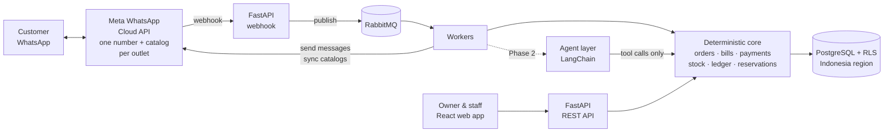

# Product Requirements Document (PRD)
## [Product Name TBD] — SME Business Automation Platform (Indonesia)

**Status:** Draft v0.6
**Date:** September 13, 2026
**Prepared by:** Hasnan
**Market:** Indonesia (UMKM — restaurants and cafes first; marketplace dropshippers in Phase 3)

**Change log**
- **v0.6** — Added Given/When/Then acceptance criteria for every MVP requirement, the non-functional requirements, and the Phase 2 agent guardrails. The AI agent can never restock or reorder on its own. Delivery uses a flat fee per outlet. Unpaid-order timer stops once the customer sends payment proof.
- **v0.5** — Dine-in payment mode (pay first or open bill) is set per outlet by the owner. MVP starts every tenant with a sample menu pushed to the WhatsApp catalog. Added end-of-shift cash count, a 15-minute table hold for reservations, and ordering for non-members. Split bills and reservation deposits are out of scope.
- **v0.4** — WhatsApp ordering moved to the WhatsApp catalog, with one WhatsApp number and catalog per outlet. Added open bills for dine-in, cash payments, per-outlet prices, menu add-ons, and duplicate-safe message processing.
- **v0.3** — Multi-outlet support moved into the MVP. Added order lifecycle, static QRIS payments, PB1 tax, ingredient recipes, staff permissions, and customer membership consent. RabbitMQ queue moved into Phase 1. Dropshipper vertical moved to Phase 3. One phase scheme used throughout. The agent must get the customer's confirmation before placing an order.
- **v0.2** — Defined the three customer uses of WhatsApp (online ordering, menu recommendations, table reservations); added table-based reservations, rule-based recommendations, table QR ordering, and a staff counter order screen to the MVP.

---

## 1. Overview / Problem Statement

Small and medium enterprises (UMKM) in Indonesia — particularly restaurants, cafes, and marketplace dropshippers — run sales, cashflow, stock, and staff scheduling through manual or fragmented tools (notebooks, spreadsheets, disconnected apps, or basic POS software with no automation layer).

Existing local POS platforms (Moka, Majoo, Qasir, Pawoon) solve point-of-sale transactions well, but none of them unify that with WhatsApp-native customer interaction and AI-driven automation for forecasting, restocking, and customer engagement. WhatsApp is already where Indonesian SME owners and their customers spend their time — building the product around it, instead of around a separate installed app, removes the biggest adoption barrier for a UMKM owner with no time or budget for onboarding friction.

Customers use WhatsApp for three things:
- **Order** — online for pickup or delivery (paid first), or dine-in by scanning a QR code on their table (paid first or on an open bill, depending on the outlet).
- **Ask for recommendations** — e.g. best sellers, or what to order for a group.
- **Book a table** — reserve a seat for a date, time, and party size.

**Product concept:** a system that runs a business "as automatically as possible" by splitting responsibilities — a **deterministic core** for anything that must be exact and auditable (ledger, stock, payroll), and an **AI agent layer** for anything that benefits from flexibility (customer conversation, forecasting, restock suggestions) — reachable primarily through WhatsApp, with a web dashboard for the owner and staff.

---

## 2. Goals

### Business goals
- Give SME owners a single system to run sales, cashflow, stock, and staff operations across one or more outlets with minimal manual data entry.
- Remove the "install an app" barrier for customers by making WhatsApp the primary ordering channel.
- Keep financial and inventory records provably accurate (deterministic, auditable) while still offering AI-driven convenience features.
- Ship an MVP that is deliberately built to scale — multi-tenant and multi-outlet from day one — rather than needing a rebuild after early traction.

### Non-goals (out of scope for the MVP)
- A dedicated native Android/iOS app — customers use WhatsApp, and owners/staff use the responsive web app (which includes a counter order screen).
- Offline mode — the web app requires an internet connection at each outlet.
- Support outside Indonesia.
- Dropshipper vertical and deep marketplace API sync (Shopee, Tokopedia, TikTok Shop) — Phase 3.
- Payment gateway integration and automatic payment confirmation — the MVP uses static QRIS with staff confirmation, plus cash for dine-in and counter orders (§5.11); a gateway is Phase 3.
- Taxes and charges other than PB1 and the flat delivery fee (e.g. service charge).
- Split bills — every order or bill is paid in full by one payer.
- Reservation deposits.
- Payroll disbursement or bank account integration.
- AI actions that change stock or money on their own — the agent can suggest restocks but never restocks or reorders by itself (FR4.4; see §12, Risks).

---

## 3. Target users

| User | Role | Primary surface |
|---|---|---|
| SME owner/manager | Runs the business across one or more outlets, wants visibility without manual bookkeeping; sets up menu, add-ons, prices, recipes, tables, and recommendations | Web admin app |
| On-site staff (cashier, waiter) | Enters dine-in/walk-in orders, manages open bills and payments, records stock, manages reservations and table status during service at their assigned outlet(s) | Web admin app |
| End customer | Orders online or at the table, asks for recommendations, books a table, and receives updates | WhatsApp only — never logs into the system |
| Dropshipper (marketplace seller) — *Phase 3* | Sells via marketplace + WhatsApp, no physical counter | Web admin app |

### Personas (brief)
- **"Ibu Sari," cafe owner** — 2–4 staff, wants daily cashflow and stock totals without reconciling paper receipts by hand.
- **Cashier/waiter staff** — needs to enter a walk-in order, close a table's bill, seat a reservation, or check stock quickly mid-shift.
- **End customer** — orders, asks "what's good here?", books a table, and gets order/booking updates entirely inside a WhatsApp chat.
- **"Andi," dropshipper (Phase 3)** — sells through a marketplace and WhatsApp, wants orders and stock to sync automatically with no physical POS.

---

## 4. Scope

Phases are defined in §10: **MVP = Phases 0–1**, **Phase 2 = agent layer**, **Phase 3 = scale & expansion**.

### MVP (Phases 0–1)
1. Business, outlet & staff onboarding (multi-tenant, multi-outlet; one WhatsApp number and catalog per outlet)
2. Sales / order intake via the WhatsApp catalog (deterministic, structured flow), starting from a sample menu — online orders (paid first, pickup or flat-fee delivery) and dine-in orders via table QR code (paid first or open bill, set per outlet)
3. Order lifecycle — order status, payment status, open bills, cancellation, and logged reversals
4. Payments via static QRIS (staff-confirmed) and cash for dine-in/counter orders, with an end-of-shift cash count; PB1 tax
5. Menu recommendations via WhatsApp (rule-based: owner's picks and best sellers)
6. Table reservations via WhatsApp (table-based, deterministic)
7. Cashflow ledger (deterministic, append-only)
8. Menu with per-outlet prices and add-ons; stock with ingredient recipes (deterministic, append-only movements)
9. Customer membership & data consent (PDP Law)
10. Owner/staff admin web app (React + TypeScript), including a counter order screen, order board with open bills, reservations/table view, and role-based access
11. WhatsApp Business API integration (Meta Cloud API) — catalog sync, RabbitMQ-backed duplicate-safe message processing, and template messages for outside-window notifications (e.g. reservation reminders)

### Phase 2 — Agent layer
12. AI agent layer (LangChain): free-text order parsing, free-text reservation requests, conversational recommendations, FAQ handling, upsell suggestions, demand forecasting, restock suggestions (advisory only)

### Phase 3 — Scale & expansion
13. Staff/manpower scheduling & attendance
14. Payment gateway (dynamic QRIS with automatic payment confirmation)
15. Dropshipper vertical and marketplace integrations (Shopee, Tokopedia, TikTok Shop)

---

## 5. Functional requirements

Each requirement is tagged by type — **Deterministic** (rule-based, must be exact/auditable) or **Agent** (AI-driven, advisory or automated) — and by phase: **MVP** (Phases 0–1), **Phase 2**, or **Phase 3** (see §10).

**Acceptance criteria.** Each subsection ends with acceptance criteria written as **Given** (starting state) / **When** (action) / **Then** (expected result). A requirement is done only when all of its criteria pass. Criteria cover every MVP requirement, the non-functional requirements (§6), and the Phase 2 agent guardrails (§5.6); the rest of Phase 2 and Phase 3 get criteria when those phases are planned. Amounts, names, and settings in the criteria are test values, not product defaults.

### 5.1 Business, outlets & staff
- **FR1.1** — System shall onboard a new tenant business with a profile (name, type: restaurant/cafe). The dropshipper type is Phase 3. *[Deterministic · MVP]*
- **FR1.2** — A tenant has one or more outlets. Each outlet has its own address, opening hours, time zone, WhatsApp number and catalog, menu prices, dine-in payment mode, flat delivery fee, PB1 setting, static QRIS code, tables, stock levels, and reservation settings. Menu items, add-ons, recipes, and owner's picks are shared across the tenant's outlets. *[Deterministic · MVP]*
- **FR1.3** — Owner creates a staff account using a dedicated email address the owner has set up for that staff member, assigns it to one or more outlets, and can deactivate it. Staff cannot self-register. *[Deterministic · MVP]*
- **FR1.4** — Staff log in with that email and a password, and only see data for the outlets they are assigned to. *[Deterministic · MVP]*
- **FR1.5** — Access is role-based (owner vs. staff), as shown in the table below. *[Deterministic · MVP]*
- **FR1.6** — Every order reversal records who did it, when, and a required reason. The owner can review all reversals in an audit log. *[Deterministic · MVP]*

| Action | Owner | Staff |
|---|---|---|
| Enter orders at the counter and move orders through their statuses | ✓ | ✓ |
| Open and close bills; take cash payments and mark QRIS payments as received | ✓ | ✓ |
| Open and close a cashier shift, including the end-of-shift cash count | ✓ | ✓ |
| Record stock movements (restock, waste, adjustment) | ✓ | ✓ |
| Reverse an order (reason required, logged — FR1.6) | ✓ | ✓ |
| Handle reservations on the day (seat, no-show, walk-in tables) | ✓ | ✓ |
| Edit menu, add-ons, prices, recipes, and recommendations | ✓ | — |
| Log expenses, view cashflow and reports | ✓ | — |
| Manage outlets (including dine-in payment mode and delivery fee), WhatsApp numbers, tables, QRIS codes, PB1 settings, and staff accounts | ✓ | — |

**Acceptance criteria**
- **AC1.1** (FR1.1) — **Given** a business name and a type of restaurant or cafe, **when** the tenant is created, **then** it exists with its creator as owner, and "dropshipper" is not an available type.
- **AC1.2** (FR1.2) — **Given** a tenant with outlets A and B, **when** the owner sets a different price, PB1 rate, QRIS code, payment mode, and delivery fee for each, **then** orders at each outlet use only that outlet's settings, while a menu item, add-on, or recipe edited once shows the change at both outlets.
- **AC1.3** (FR1.3) — **Given** the owner enters a staff email and assigns outlet A, **when** they save, **then** that staff member can log in with the email, and there is no page where anyone can create a staff account without the owner.
- **AC1.4** (FR1.3) — **Given** a staff account is deactivated, **when** that person tries to log in or uses a session that was already open, **then** access is refused.
- **AC1.5** (FR1.4) — **Given** a staff member assigned only to outlet A, **when** they request any outlet B data — through the app or by calling the API directly — **then** no outlet B data is returned.
- **AC1.6** (FR1.5) — **Given** a logged-in staff member, **when** they attempt any owner-only action in the table above (e.g. change a price, log an expense, open cashflow reports), **then** it is refused and nothing changes; every staff action in the table succeeds.
- **AC1.7** (FR1.6) — **Given** a staff member reverses an order, **when** they submit without a reason, **then** the reversal is blocked; **when** they submit with a reason, **then** the owner's audit log shows the order, the staff member, the time, and the reason.

### 5.2 Sales / order intake (WhatsApp)
- **FR2.0** — When a customer messages an outlet's WhatsApp number, the bot shows a main menu with up to three reply buttons: **Pesan** (order), **Rekomendasi** (recommendations), and **Reservasi** (book a table). Reservasi appears only if the outlet has reservations enabled. *[Deterministic · MVP]*
- **FR2.1** — Customer browses the outlet's menu in its WhatsApp catalog — photos, descriptions, and that outlet's prices — and adds items to the WhatsApp cart. Sold-out items show as unavailable. *[Deterministic · MVP]*
- **FR2.2** — When the customer sends the cart, the bot asks for add-ons for each item that has them, using reply buttons (up to 3 options) or list messages (up to 10 options), then shows an order summary (items, add-ons, subtotal, PB1, delivery fee if any, total) for the customer to confirm. Add-ons are collected in this step because the WhatsApp cart can't hold them. *[Deterministic · MVP]*
- **FR2.3** — Placing an order checks and deducts ingredient stock for its items and add-ons (FR4.6) and starts the order lifecycle (§5.10). Online orders wait for payment first; dine-in orders follow the outlet's payment mode (FR10.8). The sale is posted to the ledger when payment is confirmed (FR11.3, FR11.4). *[Deterministic · MVP]*
- **FR2.4** — Customer can place a free-text, natural-language order; the agent parses it, shows the customer a structured summary (items, add-ons, quantities, total including PB1), and calls the same order-creation function as FR2.3 only after the customer explicitly confirms. *[Agent · Phase 2]*
- **FR2.5** — System sends an order confirmation to the customer; if outside the 24-hour WhatsApp session window, it uses a pre-approved message template. *[Deterministic · MVP]*
- **FR2.6** — For online orders, customer chooses pickup or delivery. Delivery orders capture a delivery address and add the outlet's flat delivery fee, set by the owner. The fee is shown as its own line in the order summary, is not included in the PB1 calculation, and is recorded in the ledger separately from menu sales. *[Deterministic · MVP]*
- **FR2.7** — Each table has a QR code that opens a chat with its outlet's WhatsApp number, pre-filled with a table identifier; orders placed from it are tagged as dine-in for that table and follow the outlet's payment mode (FR10.8). *[Deterministic · MVP]*
- **FR2.8** — Every order records its channel (`whatsapp_online`, `whatsapp_table`, or `counter`), and all channels use the same order-creation function as FR2.3. *[Deterministic · MVP]*
- **FR2.9** — If an item sells out between the customer viewing the menu and confirming, the order is not created. The bot tells the customer which item just ran out and lets them remove it or choose something else. The Phase 2 agent follows the same rule. *[Deterministic · MVP]*
- **FR2.10** — Each outlet has its own WhatsApp number, so the number a customer messages tells the system which outlet (and tenant) the conversation belongs to. *[Deterministic · MVP]*
- **FR2.11** — Our system is the source of truth for the menu. Menu items, photos, each outlet's prices, and availability are pushed to that outlet's WhatsApp catalog whenever they change. Every menu item needs a photo, because Meta requires one for catalog items. Catalog updates can take a short time to appear, so FR2.9 re-checks stock when the customer confirms. *[Deterministic · MVP]*
- **FR2.12** — Each new tenant starts with a sample menu (items, photos, per-outlet prices, and add-ons) in our system, pushed to each outlet's WhatsApp catalog through the same sync as FR2.11. The owner replaces it with the real menu. *[Deterministic · MVP]*

**Acceptance criteria**
- **AC2.1** (FR2.0) — **Given** a customer with no order or booking in progress, **when** they message an outlet that has reservations enabled, **then** the bot replies with exactly three buttons: Pesan, Rekomendasi, Reservasi; at an outlet with reservations disabled, only Pesan and Rekomendasi appear.
- **AC2.2** (FR2.1) — **Given** a customer taps Pesan, **when** they open the catalog, **then** it shows every active menu item with its photo, description, and that outlet's price, and sold-out items are marked unavailable.
- **AC2.3** (FR2.2) — **Given** a cart containing an item with a required add-on group, **when** the customer sends the cart, **then** the bot asks for that group before showing the summary and doesn't continue until an option is chosen; optional groups can be skipped.
- **AC2.4** (FR2.2) — **Given** add-ons are chosen, **when** the bot shows the summary, **then** it lists each item with quantity and add-ons, the subtotal, PB1, the delivery fee (delivery orders only), and the total, all matching the outlet's prices and settings; no order exists until the customer taps Confirm.
- **AC2.5** (FR2.3) — **Given** the customer taps Confirm, **when** the order is created, **then** ingredient stock drops by the recipe amounts for every item and add-on, and no sale entry exists in the ledger until payment is confirmed.
- **AC2.6** (FR2.5) — **Given** an order was just created, **when** creation succeeds, **then** the customer receives one confirmation message with the order number, items, and total.
- **AC2.7** (FR2.6) — **Given** an online order at an outlet with a Rp10.000 delivery fee and 10% PB1, **when** the customer chooses delivery for a Rp50.000 subtotal, **then** the bot requires an address before the summary, and the summary shows PB1 Rp5.000, delivery Rp10.000, total Rp65.000; **when** they choose pickup, **then** no address is asked and no fee is added.
- **AC2.8** (FR2.7) — **Given** the QR code for table 5 at outlet A, **when** a customer scans it and sends the pre-filled message, **then** the chat is with outlet A's number and the resulting order is tagged dine-in, table 5, channel `whatsapp_table`.
- **AC2.9** (FR2.8) — **Given** one order each from online WhatsApp, a table QR code, and the counter screen, **when** they are viewed, **then** each shows the correct channel, and all three deducted stock and recorded order events in the same way.
- **AC2.10** (FR2.9) — **Given** one portion of an item is left, **when** two customers confirm orders containing it at the same moment, **then** exactly one order is created, stock never goes below zero, and the other customer gets a message naming the sold-out item with options to remove it or choose another item.
- **AC2.11** (FR2.10) — **Given** a tenant with outlets A and B, **when** a customer messages outlet B's number, **then** the menu, prices, and any resulting order or booking belong to outlet B.
- **AC2.12** (FR2.11) — **Given** the owner changes a price at outlet A, or an item sells out there, **when** the change is saved, **then** an update to outlet A's catalog is queued straight away and retried until it succeeds (NFR4); outlet B's catalog is untouched.
- **AC2.13** (FR2.12) — **Given** a new tenant with one outlet, **when** the outlet's WhatsApp catalog is connected, **then** the sample items appear in the catalog, their add-ons work in the bot, and the owner can edit or delete every sample item.

### 5.3 Cashflow
- **FR3.1** — Every sale, refund, reversal, or manual expense creates an append-only ledger entry for its outlet; entries are never overwritten or deleted, only reversed with a new entry. Payment entries record the method (cash or QRIS). *[Deterministic · MVP]*
- **FR3.2** — Owner can log a manual cash expense via the admin app. *[Deterministic · MVP]*
- **FR3.3** — Owner sees daily/weekly/monthly cashflow summaries and trends, per outlet and across all outlets, with cash and QRIS totals, and PB1 collected, shown separately. *[Deterministic · MVP]*
- **FR3.4** — System flags unusual cashflow patterns (e.g. an expense spike) for owner review. *[Agent · Phase 2]*

**Acceptance criteria**
- **AC3.1** (FR3.1) — **Given** any ledger entry, **when** anyone — owner, staff, the agent, or a direct API call — tries to edit or delete it, **then** the attempt is rejected; a correction can only be added as a new reversal entry that references the original.
- **AC3.2** (FR3.1) — **Given** an order paid by QRIS, **when** the ledger is checked, **then** it holds separate entries for menu sales, PB1, and the delivery fee (if any), each tagged with the outlet and the payment method QRIS.
- **AC3.3** (FR3.2) — **Given** the owner logs a Rp50.000 expense for outlet A, **when** it is saved, **then** a ledger entry shows the amount, description, date, outlet, and owner; staff can't open this screen.
- **AC3.4** (FR3.3) — **Given** a day of recorded sales, payments, and expenses, **when** the owner opens the daily, weekly, or monthly summary for one outlet or all outlets, **then** every figure equals the sum of the matching ledger entries, cash, QRIS, and PB1 are shown separately, and day boundaries follow each outlet's time zone.

### 5.4 Menu, stock & inventory
- **FR4.1** — Owner can add and edit menu items, add-ons, ingredients, recipes, and per-outlet prices. Owner and staff can record stock movements (restock, waste, adjustment); stock levels are never edited directly, only changed through movements (FR4.2). *[Deterministic · MVP]*
- **FR4.2** — Every stock change (sale, cancellation, restock, waste, adjustment) is logged per outlet as an append-only movement with the user who made it, never an overwrite. *[Deterministic · MVP]*
- **FR4.3** — Admin app shows current ingredient stock per outlet and low-stock warnings against a configurable threshold. *[Deterministic · MVP]*
- **FR4.4** — System suggests restock quantities/timing based on historical sales velocity. Suggestions are advisory only: the agent can never record a restock, change stock, or place an order with a supplier. The owner decides and records any restock (FR4.1). *[Agent · Phase 2]*
- **FR4.5** — Each menu item has a recipe listing its ingredients, quantities, and units (e.g. *Es Kopi Susu* = 18 g coffee beans + 150 ml milk + 20 ml palm sugar syrup + 1 cup). Items sold as-is (e.g. bottled water) use a one-ingredient recipe. *[Deterministic · MVP]*
- **FR4.6** — When an order is placed, all ingredients for its items and add-ons are checked and deducted in a single database transaction, so two customers can never both get the last portion. *[Deterministic · MVP]*
- **FR4.7** — A menu item is marked sold out at an outlet — and shown as unavailable in the catalog and left out of recommendations — when any ingredient is too low for one portion. An add-on option is likewise unavailable when its ingredients run low. *[Deterministic · MVP]*
- **FR4.8** — Each outlet sets its own price for every menu item and add-on option. *[Deterministic · MVP]*
- **FR4.9** — Menu items can have add-on groups, each with up to 10 options — for example *Size*: regular / large (pick one, required) or *Extras*: extra shot, oat milk (pick any, optional). An option can add to the price (or be free) and can add ingredients or change quantities in the item's recipe; those ingredients are checked and deducted with the item (FR4.6). *[Deterministic · MVP]*

**Acceptance criteria**
- **AC4.1** (FR4.1) — **Given** 1,000 g of coffee beans at outlet A, **when** staff record a 500 g restock, **then** a restock movement is added and stock shows 1,500 g; there is no way in the app or API to type in a new stock level directly.
- **AC4.2** (FR4.2) — **Given** any stock movement, **when** anyone tries to edit or delete it, **then** it is rejected; every movement shows its type, quantity, outlet, user, and time.
- **AC4.3** (FR4.3) — **Given** milk's low-stock threshold is 2,000 ml at outlet A, **when** milk at outlet A drops below 2,000 ml, **then** a low-stock warning for milk appears for outlet A only.
- **AC4.4** (FR4.5, FR4.6) — **Given** the Es Kopi Susu recipe in FR4.5, **when** an order for 2 is created, **then** stock drops by exactly 36 g coffee beans, 300 ml milk, 40 ml palm sugar syrup, and 2 cups.
- **AC4.5** (FR4.9) — **Given** the "extra shot" option adds Rp5.000 and 18 g coffee beans, **when** one Es Kopi Susu with extra shot is ordered, **then** the item price includes Rp5.000 and 36 g coffee beans are deducted.
- **AC4.6** (FR4.9) — **Given** an add-on group with 10 options, **when** the owner tries to add an 11th, **then** it is refused.
- **AC4.7** (FR4.7) — **Given** 100 ml of milk left at outlet A, **when** stock is updated, **then** every item needing more than 100 ml milk per portion is marked sold out at outlet A only, shown as unavailable in outlet A's catalog, and left out of outlet A's recommendations; after a restock, it becomes available again.
- **AC4.8** (FR4.8) — **Given** Es Kopi Susu costs Rp25.000 at outlet A and Rp28.000 at outlet B, **when** it is ordered at each outlet, **then** each order uses its own outlet's price.

### 5.5 Manpower / staff (Phase 3)
- **FR5.1** — System records staff shifts and attendance. *[Deterministic · Phase 3]*
- **FR5.2** — System suggests shift schedules based on historical demand patterns. *[Agent · Phase 3]*

### 5.6 WhatsApp bot / chatbot
- **FR6.1** — Integration via the official Meta WhatsApp Cloud API or an authorized Business Solution Provider (BSP). *[Deterministic/infra · MVP]*
- **FR6.2** — All business-initiated messages sent outside the 24-hour customer service window use a Meta-approved template. *[Deterministic/constraint · MVP]*
- **FR6.3** — An LLM-based agent (LangChain) handles FAQs and free-text conversation. Any state-changing action is routed through a deterministic tool call, never a direct database write; any order or booking needs the customer's explicit confirmation first; and the agent can never change stock on its own (FR4.4). *[Agent · Phase 2]*
- **FR6.4** — Incoming WhatsApp webhooks and outgoing messages are processed through a RabbitMQ queue (NFR4), and each incoming message is processed only once (NFR8). *[Deterministic/infra · MVP]*

**Acceptance criteria**
- **AC6.1** (FR6.2) — **Given** a customer's last message was more than 24 hours ago, **when** the system sends them any message (e.g. a reservation reminder), **then** it uses a Meta-approved template; a free-form message is never sent outside the window.

**Acceptance criteria — Phase 2 agent guardrails**
- **AC6.2** (FR2.4, FR6.3) — **Given** the agent has understood a free-text order, **when** the customer has not explicitly confirmed the summary, **then** no order exists and no stock has been deducted.
- **AC6.3** (FR4.4) — **Given** the agent produces a restock suggestion, **when** the owner has not acted on it, **then** no stock movement or supplier order exists; the agent has no tool that can change stock.
- **AC6.4** (FR6.3) — **Given** the agent creates an order or booking after customer confirmation, **when** the records are inspected, **then** they were written through the same functions staff use, with the actor recorded as "agent", and the agent's database credentials cannot write to ledger or stock tables directly.

### 5.7 Admin web app
- **FR7.1** — Owner and staff log in (FR1.4) and see views based on their role and assigned outlets (React + TypeScript). *[Deterministic · MVP]*
- **FR7.2** — Owner dashboard shows sales, cashflow, and stock summaries per outlet and for all outlets combined. Staff see only their outlets' orders, open bills, reservations, and stock. *[Deterministic · MVP]*
- **FR7.3** — App is responsive and usable on both desktop and mobile browsers. *[Deterministic · MVP]*
- **FR7.4** — Staff can create dine-in, takeaway, and walk-in orders from a counter order screen, including add-ons; dine-in orders follow the outlet's payment mode (FR10.8). These use the same order-creation function as FR2.3. *[Deterministic · MVP]*

**Acceptance criteria**
- **AC7.1** (FR7.1, FR7.2) — **Given** the owner logs in, **then** the dashboard shows sales, cashflow, and stock for each outlet and all outlets combined; **given** a staff member logs in, **then** they see only orders, open bills, reservations, and stock for their outlets, and no cashflow figures.
- **AC7.2** (FR7.3) — **Given** a phone browser 360 px wide, **when** staff use the counter screen, order board, open bills, stock, and reservations screens, **then** every action can be completed without horizontal scrolling.
- **AC7.3** (FR7.4) — **Given** staff create a dine-in order for table 3 with add-ons on the counter screen, **when** they submit, **then** the order has channel `counter`, deducts stock the same way as a WhatsApp order, and follows the outlet's payment mode.

### 5.8 Recommendations (WhatsApp)
- **FR8.1** — Owner can mark products as "owner's picks" and tag them (e.g. coffee, sweet, good for sharing) in the admin app. *[Deterministic · MVP]*
- **FR8.2** — Tapping **Rekomendasi** sends the owner's picks, then the outlet's best sellers (most units sold at that outlet in the last 30 days), as a product message from the outlet's catalog — up to 30 items, no item listed twice, excluding sold-out items (FR4.7). *[Deterministic · MVP]*
- **FR8.3** — Customer can add recommended items straight to their cart from that message. *[Deterministic · MVP]*
- **FR8.4** — Customer can ask for recommendations in free text (e.g. "something sweet for 4 people under Rp200rb"); the agent answers using menu, stock, and sales data. Suggestions are advisory — nothing is added to an order until the customer confirms. *[Agent · Phase 2]*

**Acceptance criteria**
- **AC8.1** (FR8.1, FR8.2) — **Given** the owner marked 3 items as owner's picks and one of them is sold out, **when** a customer taps Rekomendasi, **then** the message shows the 2 available picks first, followed by best sellers.
- **AC8.2** (FR8.2) — **Given** sales at outlet A over the last 30 days, **when** the message is built, **then** best sellers are ordered by units sold at outlet A in that period, an item that is both a pick and a best seller appears once, and the message never has more than 30 items.
- **AC8.3** (FR8.3) — **Given** the recommendation message, **when** the customer adds items and sends the cart, **then** the normal order flow (add-ons, summary, confirm) continues.

### 5.9 Reservations & tables
- **FR9.1** — For each outlet, owner can define tables (name/number, seat capacity, optional area such as indoor/outdoor) and reservation settings (bookable hours, default booking duration, how far ahead customers can book, maximum party size, reminder time, cancellation cutoff). *[Deterministic · MVP]*
- **FR9.2** — Customer can book through a structured WhatsApp flow: party size → date → available time → confirm. The system assigns the smallest free table that fits the party. *[Deterministic · MVP]*
- **FR9.3** — A table can never be double-booked for overlapping times; this is enforced at the database level, not only in application code. *[Deterministic · MVP]*
- **FR9.4** — System sends a booking confirmation immediately and a reminder at the outlet's configured time before the booking; reminders outside the 24-hour window use a pre-approved template. *[Deterministic · MVP]*
- **FR9.5** — Customer can cancel or reschedule a booking via WhatsApp up to the outlet's cancellation cutoff before the booking time. *[Deterministic · MVP]*
- **FR9.6** — Staff can view the day's reservations per table in the admin app, add bookings taken by phone or in person, reassign tables, and mark a booking as seated, completed, cancelled, or no-show. Every status change records who made it. *[Deterministic · MVP]*
- **FR9.7** — Staff can mark a table as occupied by walk-in guests so it isn't offered for overlapping bookings. *[Deterministic · MVP]*
- **FR9.8** — Reservation times are stored and shown in the outlet's local time zone (WIB/WITA/WIT). *[Deterministic · MVP]*
- **FR9.9** — Customer can request a booking in free text (e.g. "meja buat 4 orang besok jam 7 malam"); the agent parses it, confirms the details with the customer, and calls the same booking function as FR9.2. *[Agent · Phase 2]*
- **FR9.10** — A booking holds its table for 15 minutes after the booking time. If the guests haven't been seated by then, the booking is marked no-show automatically and the table is released. No deposit is taken. *[Deterministic · MVP]*

**Acceptance criteria**
- **AC9.1** (FR9.1) — **Given** outlet A's maximum party size is 6, **when** a customer asks to book for 7, **then** the bot says the maximum is 6 and offers no times.
- **AC9.2** (FR9.2) — **Given** tables T1 (2 seats), T2 (4 seats), and T3 (6 seats) are all free at 19:00, **when** a party of 4 books 19:00, **then** T2 is assigned.
- **AC9.3** (FR9.2) — **Given** outlet A's bookable hours and booking window, **when** the bot offers times, **then** it only offers times inside those hours and that window where at least one table that fits the party is free.
- **AC9.4** (FR9.3) — **Given** T2 is booked 19:00–20:30, **when** anyone books T2 for an overlapping time — including two requests at the same moment, or a write that skips the application's checks — **then** the database rejects the second booking.
- **AC9.5** (FR9.4) — **Given** outlet A's reminder time is 2 hours, **when** a booking for 19:00 is confirmed, **then** the customer immediately gets a confirmation with outlet, date, time, and party size, and gets a reminder at 17:00.
- **AC9.6** (FR9.5) — **Given** outlet A's cancellation cutoff is 2 hours, **when** a customer cancels a 19:00 booking at 16:00, **then** it is cancelled and the table is freed; **when** they try at 18:00, **then** the bot refuses and tells them to contact the outlet.
- **AC9.7** (FR9.6) — **Given** today's bookings, **when** staff add a phone booking, reassign a table, or mark a booking seated, completed, cancelled, or no-show, **then** the change is saved and shows who made it and when.
- **AC9.8** (FR9.7) — **Given** staff mark T2 as occupied by walk-ins, **when** a customer asks for a time that overlaps before staff mark T2 free, **then** T2 is not offered.
- **AC9.9** (FR9.8) — **Given** an outlet in Makassar (WITA), **when** a customer books 19:00, **then** the bot and the admin app both show 19:00 WITA.
- **AC9.10** (FR9.10) — **Given** a booking at 19:00, **when** the guests have not been seated by 19:15, **then** the booking is marked no-show automatically and T2 becomes bookable again; **when** staff seat them at 19:14, **then** the booking stays seated.

### 5.10 Order lifecycle
- **FR10.1** — Each order has an **order status** and a separate **payment status**. *[Deterministic · MVP]*

  | Order status | Meaning |
  |---|---|
  | `pending_payment` | Waiting for payment — online orders, and dine-in orders at pay-first outlets |
  | `confirmed` | Accepted by the outlet — pay-first orders once paid; open-bill dine-in and counter orders immediately |
  | `preparing` | Kitchen/bar is making it |
  | `ready` | Ready to serve or to pick up |
  | `out_for_delivery` | Delivery orders only |
  | `served` | Open-bill dine-in only: delivered to the table; waiting for the bill to be paid |
  | `completed` | Handed over and paid |
  | `cancelled` | Stopped before completion |

  Payment status: `unpaid` → `paid` → `refunded` (only through a reversal).

  - **Online orders (paid first):** `pending_payment` → `confirmed` → `preparing` → `ready` → `out_for_delivery` (delivery only) → `completed`. An online order can't be prepared until it is paid.
  - **Dine-in orders at pay-first outlets:** `pending_payment` → `confirmed` → `preparing` → `ready` → `completed`. The order can't be prepared until it is paid.
  - **Dine-in orders at open-bill outlets (paid at the end):** `confirmed` → `preparing` → `ready` → `served` → `completed` when the bill is paid (FR10.6).
  - **Takeaway and walk-in counter orders:** `confirmed` → `preparing` → `ready` → `completed` — completed only once paid.
- **FR10.2** — Staff move orders through their statuses from an order board in the admin app; every change records who made it and when. *[Deterministic · MVP]*
- **FR10.3** — Customer gets a WhatsApp update when their order is confirmed, ready, out for delivery, or cancelled. *[Deterministic · MVP]*
- **FR10.4** — Unpaid pay-first orders (online, and dine-in at pay-first outlets) are cancelled automatically after a configurable time per outlet; their ingredients go back into stock and the customer is notified. The timer stops once the customer sends a payment screenshot, so an order waiting for staff to verify payment is never cancelled automatically. *[Deterministic · MVP]*
- **FR10.5** — Cancelling an unpaid order returns its ingredients to stock with a reversal movement. Reversing a paid order requires a reason (FR1.6), creates a refund entry in the ledger, and either returns the ingredients to stock (not yet prepared) or records them as waste (already prepared). The refund itself is paid back to the customer manually, outside the system. *[Deterministic · MVP]*
- **FR10.6** — At open-bill outlets, dine-in orders go on an **open bill** for a table, or for a guest name when there's no table. Orders from the table QR code or the counter are added to the bill without paying first, and a table has at most one open bill. When the guests are done, staff close the bill: the customer pays the total (including PB1) by cash or QRIS, all orders on the bill become `completed`, and the sale is posted to the ledger. A bill is always paid in full by one payer; there are no split bills. *[Deterministic · MVP]*
- **FR10.7** — Staff see all open bills for their outlet, with running totals and how long each has been open. *[Deterministic · MVP]*
- **FR10.8** — Owner sets each outlet's dine-in payment mode: **pay first** (dine-in orders are paid before they're prepared, like online orders) or **open bill** (FR10.6). Customers aren't asked; the bot and the counter screen follow the outlet's mode. Online orders are always paid first. *[Deterministic · MVP]*

**Acceptance criteria**
- **AC10.1** (FR10.1) — **Given** an unpaid online order in `pending_payment`, **when** staff try to move it to `preparing`, **then** the change is refused; any other move that isn't in the order's flow is refused the same way.
- **AC10.2** (FR10.1) — **Given** an unpaid counter or open-bill order, **when** staff try to mark it `completed`, **then** the change is refused.
- **AC10.3** (FR10.2) — **Given** any order, **when** its status changes, **then** the order history shows the old status, new status, who made the change, and when.
- **AC10.4** (FR10.3) — **Given** a delivery order, **when** it becomes `confirmed`, `ready`, `out_for_delivery`, or `cancelled`, **then** the customer receives exactly one WhatsApp message for each change.
- **AC10.5** (FR10.4) — **Given** outlet A's unpaid-order time limit is 15 minutes, **when** a pay-first order has no payment and no screenshot after 15 minutes, **then** it is cancelled, its ingredients are returned with a reversal movement, and the customer is notified; **when** the customer sends a screenshot at minute 10, **then** the order is not cancelled automatically at minute 15.
- **AC10.6** (FR10.5) — **Given** a paid order, **when** staff reverse it before preparation, **then** a reason is required, a refund entry is added to the ledger, and ingredients are returned to stock; **when** staff reverse it after preparation, **then** the ingredients are recorded as waste instead.
- **AC10.7** (FR10.6) — **Given** table 5 at an open-bill outlet has no open bill, **when** its first order is placed, **then** a bill is opened; **when** a second order is placed from the table QR or the counter, **then** it joins the same bill, and table 5 can never have two open bills.
- **AC10.8** (FR10.6) — **Given** an open bill with two orders, **when** staff close it, **then** the bill total equals the two orders plus PB1, it can only be paid in full in one payment, and once paid both orders become `completed` and the sale is posted to the ledger.
- **AC10.9** (FR10.7) — **Given** three open bills at outlet A, **when** staff open the open-bills view, **then** each shows its table or guest name, running total, and how long it has been open.
- **AC10.10** (FR10.8) — **Given** outlet A is set to pay first, **when** a table-QR order is placed, **then** it starts as `pending_payment` and the bot sends QRIS; **given** the owner switches outlet A to open bill, **when** the next table-QR order is placed, **then** it is `confirmed` on the table's bill without payment, and orders created before the switch keep their original flow. Customers are never asked to choose.

### 5.11 Payments & tax
- **FR11.1** — Owner uploads each outlet's static QRIS code in the admin app. *[Deterministic · MVP]*
- **FR11.2** — After an online order — or a dine-in order at a pay-first outlet — is placed through WhatsApp, the bot sends the outlet's QRIS image and the exact total (including PB1), and asks the customer to pay that amount and send the payment screenshot in the chat. Because the QRIS is static, the customer types the amount into their payment app. *[Deterministic · MVP]*
- **FR11.3** — Staff check that the payment arrived in the outlet's QRIS merchant account, then mark the order paid in the admin app, with the customer's screenshot attached to the order. Only then is the sale posted to the ledger. Staff must never mark an order paid based on the screenshot alone. *[Deterministic · MVP]*
- **FR11.4** — Dine-in orders (pay-first or open bill) and takeaway/walk-in counter orders can be paid by cash at the counter or with the outlet's QRIS; staff record which method was used. QRIS payments are confirmed the same way as FR11.3. Online orders can't be paid in cash. *[Deterministic · MVP]*
- **FR11.5** — Owner sets the PB1 rate per outlet, or turns PB1 off for outlets not registered for it. PB1 is calculated on the subtotal (including add-ons, excluding the delivery fee), rounded to the nearest rupiah, shown as a separate line in the order or bill summary, and posted to the ledger separately from revenue. *[Deterministic · MVP]*
- **FR11.6** — For cash payments, staff enter the amount received and the system shows the change due. *[Deterministic · MVP]*
- **FR11.7** — Staff open a cashier shift for their outlet's cash drawer by entering the starting cash. Only one shift can be open per drawer, cash payments can't be taken without an open shift, and every cash payment and cash refund during the shift is linked to it. *[Deterministic · MVP]*
- **FR11.8** — At the end of the shift, staff count the cash in the drawer and enter the amount before seeing what the system expects. The system compares it with the expected cash (starting cash + cash received − cash paid out), records the difference and who counted, and posts any shortage or surplus to the ledger. The owner sees every shift's count and difference. *[Deterministic · MVP]*
- **FR11.9** — Payments are confirmed automatically through a payment gateway (dynamic QRIS), removing the manual check in FR11.3. *[Deterministic · Phase 3]*

**Acceptance criteria**
- **AC11.1** (FR11.1, FR11.2) — **Given** outlet A's QRIS image is uploaded, **when** a pay-first order with a Rp55.000 total is placed through WhatsApp, **then** the bot sends outlet A's QRIS image and the amount Rp55.000, and asks for the payment screenshot.
- **AC11.2** (FR11.2) — **Given** an order waiting for payment, **when** the customer sends an image in the chat, **then** it is attached to that order and the order shows on the staff order board as waiting for payment check.
- **AC11.3** (FR11.3) — **Given** an order with a screenshot attached, **when** staff mark it paid, **then** the payment status becomes `paid`, the payment records the staff member and time, and the ledger entries are created at that moment — not when the screenshot arrived.
- **AC11.4** (FR11.4) — **Given** a counter or dine-in order, **when** staff take payment, **then** they must choose cash or QRIS and the choice is saved; **given** an online order, **then** cash is not offered.
- **AC11.5** (FR11.5) — **Given** PB1 is 10% at outlet A and off at outlet B, **when** a Rp50.000 order is placed at each, **then** outlet A's summary shows PB1 Rp5.000 and outlet B's shows no PB1 line; at outlet A, PB1 is posted to the ledger as its own entry.
- **AC11.6** (FR11.6) — **Given** a Rp47.000 total, **when** staff enter Rp50.000 cash received, **then** the change due shows Rp3.000; an amount below Rp47.000 can't be recorded as full payment.
- **AC11.7** (FR11.7) — **Given** no shift is open at outlet A's drawer, **when** staff try to take a cash payment, **then** they are asked to open a shift first; **when** a shift is already open, **then** a second one can't be opened for the same drawer.
- **AC11.8** (FR11.8) — **Given** a shift with Rp200.000 starting cash, Rp850.000 cash received, and Rp30.000 cash paid out, **when** staff enter a count of Rp1.010.000, **then** they did not see the expected amount before entering it, the system records expected Rp1.020.000 and a difference of −Rp10.000 with the staff member's name, posts a Rp10.000 shortage to the ledger, and the owner sees the shift in the cash count report.

### 5.12 Customer membership & data consent
- **FR12.1** — On a customer's first message to any of a business's outlets, the bot asks for consent to keep their data as a member of that business (name, WhatsApp number, delivery addresses, order and booking history), with a link to the privacy notice. *[Deterministic · MVP]*
- **FR12.2** — A member's personal data is kept for as long as their membership (consent) is active. *[Deterministic · MVP]*
- **FR12.3** — A customer can end their membership at any time from WhatsApp. Their personal data is then deleted or anonymized; orders and ledger entries stay, linked to an anonymized customer record, so financial history remains intact (FR3.1). *[Deterministic · MVP]*
- **FR12.4** — Personal data lives only in customer tables and is never copied into ledger or stock records, so anonymization never has to modify append-only data. *[Deterministic · MVP]*
- **FR12.5** — A customer who declines membership can still order and book a table. Their personal data is kept only until that order or booking is finished, then anonymized. *[Deterministic · MVP]*

**Acceptance criteria**
- **AC12.1** (FR12.1) — **Given** a customer has never messaged any outlet of the business, **when** they send their first message, **then** the bot asks for membership consent with a privacy notice link; **given** they are already a member via outlet A, **when** they first message outlet B of the same business, **then** they are not asked again.
- **AC12.2** (FR12.3) — **Given** a member with past orders, **when** they end their membership from WhatsApp, **then** their name, phone number, and addresses are deleted or anonymized, and their past orders and all ledger totals are unchanged.
- **AC12.3** (FR12.4) — **Given** the full ledger and stock movement tables, **when** they are searched for customer names, phone numbers, or addresses, **then** none are found.
- **AC12.4** (FR12.5) — **Given** a customer declines membership, **when** they order or book, **then** it works normally; **when** that order is completed or cancelled (or the booking is finished), **then** their personal data is anonymized.

---

## 6. Non-functional requirements

- **NFR1 — Data residency:** Primary data storage hosted in an Indonesia-region cloud (AWS `ap-southeast-3` Jakarta, GCP Jakarta, or Alibaba Cloud Indonesia) to reduce cross-border transfer exposure under Indonesia's PDP Law (Law No. 27/2022) and to reduce latency for WhatsApp interactions.
- **NFR2 — Multi-tenancy & outlets:** Tenant data isolated at the database level using PostgreSQL row-level security (RLS), not solely application-level filtering — this closes the "forgot a `WHERE tenant_id`" failure mode. Staff access to outlets is enforced the same way.
- **NFR3 — Auditability:** The deterministic core (ledger, stock) is append-only. The AI agent layer never writes to these tables directly — only through validated deterministic functions, which log the actor (human or agent) on every write. Order status changes and reversals are logged with actor, time, and reason.
- **NFR4 — Reliability:** The WhatsApp webhook endpoint verifies the request, identifies the outlet from the receiving phone number, publishes the event to RabbitMQ, and responds immediately; workers consume the queue to run order flows, send replies, and (Phase 2) call the agent. Outgoing messages and catalog updates also go through the queue so failed or rate-limited calls are retried. This is in place from Phase 1.
- **NFR5 — Security:** Role-based access control in the admin app (FR1.5); token-based authentication for FastAPI endpoints.
- **NFR6 — Scalability:** Stateless, containerized FastAPI services and queue workers, and pooled Postgres connections, so tenant and outlet growth doesn't require a schema or architecture redesign.
- **NFR7 — Connectivity:** The web app requires an internet connection at each outlet; there is no offline mode in the MVP.
- **NFR8 — Duplicate-safe processing:** Every incoming WhatsApp message is processed at most once, using Meta's message ID; a message ID that has already been processed is ignored. This covers both Meta resending a webhook and RabbitMQ redelivering a message after a worker crash, so one tap on Confirm can never create two orders, deduct stock twice, or post two ledger entries.

**Acceptance criteria**
- **ACN1** (NFR1) — **Given** the production environment, **when** its databases, backups, and file storage (including payment screenshots) are listed, **then** every one is in an Indonesia region.
- **ACN2** (NFR2) — **Given** tenants 1 and 2 both have data, **when** any query runs as tenant 1 — including one written with no tenant filter — **then** no tenant 2 rows are returned.
- **ACN3** (NFR3) — **Given** any write to the ledger or stock movements, **when** it is inspected, **then** it records the actor (a named user, or "agent") and the time.
- **ACN4** (NFR4) — **Given** a valid webhook from Meta, **when** it arrives, **then** the endpoint returns success after queuing the event and before any order processing starts; **given** all workers are stopped, **when** webhooks keep arriving, **then** none are lost, and all are processed once workers restart.
- **ACN5** (NFR4) — **Given** a webhook with an invalid signature, **when** it arrives, **then** it is rejected and nothing is queued.
- **ACN6** (NFR5) — **Given** an API request with a missing, expired, or invalid token, **when** it reaches any FastAPI endpoint other than the webhook, **then** it is rejected.
- **ACN7** (NFR8) — **Given** a customer's Confirm tap, **when** Meta delivers that same message twice, or a worker crashes after processing it and RabbitMQ redelivers it, **then** there is exactly one order, one stock deduction, and one set of ledger entries.

---

## 7. System architecture (summary)

- **Customers** reach the system only through **WhatsApp Business API** (Meta Cloud API or an official BSP). Each outlet has its own WhatsApp number and catalog.
- **Owners and staff** use a **React + TypeScript web app** for admin, order handling, reporting, and product/stock management.
- Incoming WhatsApp events hit a **FastAPI webhook**, which puts them on a **RabbitMQ** queue for workers to process. Workers also send replies and keep each outlet's catalog in sync.
- The **FastAPI backend and workers**, hosted in an Indonesia-region cloud, are split into:
  - **Deterministic core** — PostgreSQL with row-level security; owns orders, bills, payments, stock, the ledger, and reservations, with every record scoped to a tenant and outlet.
  - **Agent layer (Phase 2)** — LangChain-based; handles conversation, forecasting, and suggestions, and calls into the deterministic core as tools rather than writing to it directly. It has no tool that changes stock.

---

## 8. Data model (high-level entities)

`tenants` · `outlets` (WhatsApp number, catalog, payment mode, delivery fee) · `users` · `staff_outlets` · `products` (menu items) · `addon_groups` · `addon_options` · `outlet_prices` (menu items and add-on options) · `product_tags` · `stock_items` (ingredients) · `recipe_items` · `stock_movements` · `bills` (open bills) · `orders` (channel, outlet, optional table or bill, order status, payment status) · `order_items` · `order_item_addons` · `order_events` (status changes and reversals, with actor and reason) · `payments` (cash or QRIS) · `cashier_shifts` (starting cash, counted cash, difference) · `ledger_entries` · `tables` · `reservations` · `reservation_events` · `whatsapp_contacts` · `customer_consents` · `conversations` · `messages` · `processed_messages` (duplicate check) · `staff_shifts` (Phase 3) · `attendance` (Phase 3)

Every operational record (stock movements, bills, orders, payments, ledger entries, tables, reservations) carries both `tenant_id` and `outlet_id`.

---

## 9. Tech stack

| Layer | Choice |
|---|---|
| Backend | FastAPI (Python) |
| Message queue | RabbitMQ |
| AI / automation | LangChain |
| Database | PostgreSQL (row-level security for multi-tenancy) |
| Admin frontend | React + TypeScript |
| Customer channel | WhatsApp Business API (Meta Cloud API / official BSP), with one number and catalog per outlet |
| Payments | Static QRIS (staff-confirmed) and cash for dine-in/counter orders (MVP); payment gateway in Phase 3 |
| Hosting | Indonesia-region cloud (AWS `ap-southeast-3`, GCP Jakarta, or Alibaba Cloud Indonesia) |

---

## 10. MVP roadmap

| Phase | Focus |
|---|---|
| **0 — Foundation** | Tenant, outlet, and staff accounts with RLS and role permissions; schema for menu, add-ons, per-outlet prices, recipes, stock, orders, bills, payments, ledger, tables, and reservations; FastAPI CRUD; React admin with menu/recipe/stock management and counter order screen |
| **1 — Deterministic WhatsApp flows** | WhatsApp number and catalog setup per outlet, with catalog sync and a sample menu; RabbitMQ-backed, duplicate-safe webhook processing; main menu (Pesan / Rekomendasi / Reservasi); catalog ordering with add-on follow-up (online + table QR), pickup or flat-fee delivery; order lifecycle with per-outlet dine-in payment mode (pay first or open bill), sold-out handling, static QRIS and cash payments with end-of-shift cash count, and PB1; rule-based recommendations; table reservations with reminders and 15-minute hold; membership consent; order board and reservations view in admin. Start the WhatsApp template approval process in parallel (order updates, reservation confirmation/reminder), since Meta's review queue is outside our control |
| **2 — Agent layer** | LangChain-based free-text ordering and booking (always confirmed by the customer), conversational recommendations, FAQ handling, upsell + forecast/restock suggestions (advisory only — the agent never changes stock) — all gated through deterministic tool calls |
| **3 — Scale & expansion** | Connection pooling and observability, staff/manpower module, payment gateway (dynamic QRIS with automatic confirmation), dropshipper vertical, marketplace integrations |

The MVP (Phases 0–1) alone is a shippable, revenue-generating product and doubles as the fallback the bot degrades to if the agent layer misbehaves. A phase is complete when every acceptance criterion for its requirements passes.

---

## 11. Success metrics (draft — needs business input, see Open Questions)

- Number of active tenant businesses onboarded
- Share of orders by channel (WhatsApp online, WhatsApp table QR, counter)
- Reservations booked through WhatsApp, and no-show rate
- Share of orders that include a recommended item
- Reduction in manual reconciliation time reported by owners
- Template message delivery/approval success rate
- System uptime and webhook response latency

---

## 12. Risks & assumptions

- **Template approval lead time:** WhatsApp template approval is controlled by Meta, not by us — the template library should be drafted and submitted early in Phase 1.
- **Per-outlet WhatsApp setup:** Every outlet needs its own WhatsApp number, Meta account setup, catalog, and possibly its own template approvals, which slows onboarding for multi-outlet businesses. Customers also have to message the right outlet. Mitigation: show each outlet's number on its signage, maps listing, and table QR codes.
- **Catalog limits:** The WhatsApp cart can't hold add-ons, and catalog updates aren't instant. Mitigation: add-ons are collected after the cart is sent (FR2.2), and stock is re-checked on confirmation (FR2.9).
- **Trust in AI suggestions:** Owners may be wary of AI-driven restock or scheduling suggestions. Mitigation: the agent is advisory-only for stock — it suggests, and the owner decides and records any restock (FR4.4). Customer-facing agent actions (orders, bookings) always require the customer's confirmation.
- **Regulatory drift:** Indonesia's PDP Law implementing regulations were still being finalized as of 2026 — the architecture should stay flexible enough to tighten data handling if requirements change.
- **Connectivity:** The web app requires internet at every outlet (NFR7). If an outlet's connection drops, staff can't enter counter orders, close bills, confirm payments, or record stock until it's restored.
- **Fake payment proof:** Static QRIS gives no automatic payment notification, so a customer could send an edited or reused screenshot. Mitigation: staff confirm every payment against the merchant account, never the screenshot alone (FR11.3).
- **Manual payment checks at peak hours:** Confirming each QRIS payment by hand can slow staff down when busy. Mitigation: payment gateway with automatic confirmation in Phase 3.
- **Unpaid open bills:** Dine-in guests pay at the end, so they could leave without paying. Mitigation: staff see every open bill and how long it has been open (FR10.7), and owners can switch an outlet to pay-first mode (FR10.8).
- **Missing cash:** Cash is easier to lose or take than QRIS payments. Mitigation: a blind end-of-shift cash count, with every difference recorded and shown to the owner (FR11.8).
- **Table QR spoofing:** The table identifier in a pre-filled WhatsApp message can be edited or reused by someone not at the table. Mitigation: include a rotating token in the QR code and/or have staff confirm the first dine-in order per table.
- **No-shows:** Free WhatsApp bookings can lead to no-shows that block tables. Mitigation: reminders (FR9.4), easy cancellation (FR9.5), the 15-minute hold (FR9.10), and no-show tracking (FR9.6).

---

## 13. Open questions

- Product name / branding — **TBD**
- Monetization model (subscription tiers, per-transaction fee, free tier for early adopters) — **TBD**
- Concrete success-metric targets and timeline milestones — **TBD**, needs business-side input
- Delivery — who delivers (outlet staff or a courier the customer books)? The fee is a flat amount per outlet (FR2.6). — **TBD**

---

## 14. Glossary

- **SME / UMKM** — Usaha Mikro, Kecil, dan Menengah; Indonesia's micro/small/medium enterprise designation.
- **Outlet** — a single physical location (branch) of a tenant business.
- **Open bill** — a running bill for a dine-in table (or guest name) that orders are added to, paid when the guests finish.
- **Cashier shift** — the period a cash drawer is in use, from the starting cash count to the end-of-shift count. Separate from staff scheduling (Phase 3).
- **Acceptance criteria** — testable Given/When/Then conditions that must all pass before a requirement counts as done.
- **WhatsApp catalog** — a product list linked to a WhatsApp Business account, where customers browse items with photos and prices and send a cart to the business.
- **PDP Law** — Indonesia's Personal Data Protection Law (Law No. 27/2022).
- **BSP** — WhatsApp Business Solution Provider, a Meta-authorized reseller of the WhatsApp Business API.
- **RLS** — Row-Level Security, a PostgreSQL feature used here for per-tenant data isolation.
- **QRIS** — Quick Response Code Indonesian Standard, Bank Indonesia's national QR payment standard. A **static QRIS** is a fixed QR code: the customer types the amount, and our system gets no automatic payment notification.
- **PB1** — the regional restaurant tax (formerly *Pajak Pembangunan 1*, now PBJT for food & beverage under Law No. 1/2022); the rate is set by each local government, up to 10%.

---

## 15. References

- Indonesian POS market landscape: [HitPay — Best POS Systems in Indonesia 2026](https://hitpayapp.com/blog/pos-system-indonesia-comparison), [MAS Software — Aplikasi POS Terbaik](https://www.mas-software.com/blog/aplikasi-pos-terbaik)
- Mobile OS market share, Indonesia: [StatCounter — Mobile OS Market Share Indonesia](https://gs.statcounter.com/os-market-share/mobile/indonesia)
- WhatsApp Business API / BSP: [Mekari Qontak — WhatsApp Business API](https://mekari.com/en/qontak/whatsapp-business-api/), [Qontak — WhatsApp API features](https://qontak.com/en/features/whatsapp-api/)
- WhatsApp 24-hour session window & templates: [Saysimple — WhatsApp 24-Hour Customer Care Window](https://helpcenter.saysimple.com/whatsapp-management/the-whatsapp-24-hour-customer-care-window), [ChakraHQ — WhatsApp Template Messages Guide](https://chakrahq.com/article/whatsapp-template-messages-complete-guide/amp/)
- Indonesia's PDP Law and data residency: [Digital Edge DC — What is UU PDP](https://id.digitaledgedc.com/colocation/uu-pdp), [Google Cloud — Indonesia PDPL compliance](https://cloud.google.com/security/compliance/indonesia-pdpl?hl=id)
- AWS Jakarta region: [AWS press release — AWS launches Region in Indonesia](https://press.aboutamazon.com/2021/12/aws-launches-region-in-indonesia)
- Postgres row-level security for multi-tenancy: [AWS Prescriptive Guidance — RLS recommendations](https://docs.aws.amazon.com/prescriptive-guidance/latest/saas-multitenant-managed-postgresql/rls.html)
