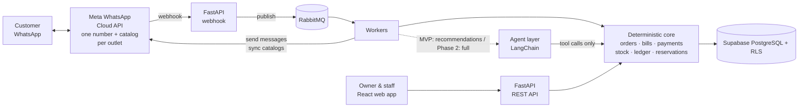

# Product Requirements Document (PRD)
## [Product Name TBD] — SME Business Automation Platform (Indonesia)

**Status:** Draft v0.19
**Date:** November 20, 2026
**Prepared by:** Hasnan
**Market:** Indonesia (UMKM — restaurants and cafes first; marketplace dropshippers in Phase 3)

**Change log**
- **v0.19** — Open bills can be **split per item** (issue #42): staff pick the items (or portions of a line) one guest pays for, take that part by cash or QRIS, and repeat until every item is paid; the bill stays open until then, and the last part completes all its orders. Each part is one payment with its own ledger entries. PB1 on an open bill is now decided: it is calculated once on the bill subtotal, and a part's PB1 is the PB1 on everything paid so far including that part minus the PB1 already paid, so the parts always add up to the bill total exactly. A paid part can be undone while the bill is open only with a reason (refund entry, items unpaid again). Split is a staff action (S5, M3); the table QR web page still shows no bill (FR2.15). Removes "Split bills" from the non-goals (FR10.6, FR10.9, AC10.8, AC10.11–AC10.15, §13). Each part can be paid by cash or static QRIS; the QRIS step shows only that part's amount and staff check the merchant account for exactly that amount before confirming.
- **v0.18** — The table QR code now opens a Thinker web page for that table instead of going straight to WhatsApp (issue #44). From the same QR the customer either orders on the web page (new channel `web_table`) or opens the outlet's WhatsApp chat (the existing `whatsapp_table` flow). **Web orders are always paid first with the outlet's static QRIS**, at open-bill and pay-first outlets alike: the customer pays, taps "Saya sudah bayar", and staff confirm the payment in the merchant account before the order goes to the kitchen; there is no screenshot upload. Web orders never join the table's open bill, and the page shows only the orders placed from that phone, so nobody can read another table's bill. Per outlet, the owner picks where the QR leads (web + WhatsApp, web only, WhatsApp only) and can replace a table's QR token. Online payment with automatic confirmation (#43) later replaces the static QRIS step (FR2.7, FR2.8, FR2.13–FR2.16, FR10.6, AC2.8, AC2.15–AC2.21, ACN6).
- **v0.17** — An outlet has at most one active attendance tablet. To replace it, the owner first forgets the current tablet ("Lupakan perangkat" in the admin app), then pairs the new one with a fresh code; while a tablet is active, new pairing codes and pairings are refused (FR5.6, AC5.7).
- **v0.16** — Attendance selfies are kept for 45 days (was 30) before automatic deletion. Staff cannot delete a selfie, not even their own; the owner may delete one earlier (API ready, no screen yet).
- **v0.15** — Purchase orders move out of Pengeluaran into their own owner Dashboard tab **PO & Supplier** (issue #16): the Pembayaran supplier card, the PO ada selisih list, and the Ringkasan PO report sit at the top, with the PO list, PO detail, supplier list, and Buka PO below (FR3.10–FR3.12). The tab has its own outlet and month filter; the month applies to Ringkasan PO only. Pengeluaran is back to direct expenses only. PO rules are unchanged.
- **v0.14** — Expenses now include purchase orders (PO) to suppliers, on a new Purchase Order tab next to direct expenses (FR3.5–FR3.12, FR4.10–FR4.11, AC3.6–AC3.14, AC4.9–AC4.10). A PO is opened, the goods that arrive are checked against the PO quantities in the admin app, and the PO is closed when they match. **Pay later** (bayar mundur): once the PO is closed, a payment reminder appears on the owner dashboard until it is paid by the due date (instalments allowed). **Pay in advance** (bayar di muka): as soon as the PO is opened, a payment request appears on the owner dashboard; the goods arrive later, are checked, and the PO is closed. The ledger stays cash-based: an expense is posted only when money is paid, never when a PO is opened, checked, or closed. Staff open POs for their outlets (straight away, no approval), cross-check deliveries, and close a PO when quantities match; a PO with a difference can't be closed by staff, shows on the owner dashboard, and only the owner can close it with a note; payments, cancellation, supplier debt, and dashboard reminders stay with the owner. Received goods add stock through restock movements.  The owner dashboard adds a Ringkasan PO report (open/closed, goods arrived or not, paid or not) and the cashflow report adds supplier debt and goods paid for but not yet received, shown apart from cash out.
- **v0.13** — Attendance details decided: selfies are kept for 30 days, staff do not enter a PIN on the attendance tablet (they tap their name and take a selfie), and a missing clock-out is flagged 1 hour after the outlet's closing time by default. The busy, quiet, and crowded thresholds stay as defaults and will be finalised during development.
- **v0.12** — The owner dashboard now shows how busy each outlet is: orders per hour with busy and quiet hours marked, a day-by-hour busyness map, and how crowded each outlet is right now (occupied tables and active orders). The owner can filter the dashboard to busy hours or quiet hours (FR7.5–FR7.8, AC7.4–AC7.7). The cashflow report adds the change against the previous period, expenses per outlet, and a list of recent expenses (FR3.3, AC3.5). The thresholds for busy, quiet, and crowded are defaults that still need business input.
- **v0.11** — Attendance is recorded only on the outlet's attendance tablet: the owner pairs a tablet to the outlet, the tablet stays signed in as that outlet, and a staff member picks their name and takes a selfie to clock in or out (FR5.1, FR5.6, FR5.7, AC5.1–AC5.2, AC5.6–AC5.8). Clocking in from a staff member's own phone or the admin app is no longer possible; staff still see their own history in the admin app. Selfies are kept in private storage, shown only to the owner and to the staff member for their own records, and there is no face recognition in the MVP. This closes the attendance verification question.
- **v0.10** — Staff attendance moves into the MVP (Phase 1, and the pilot): staff clock in and out from the admin app, a forgotten clock-out is flagged instead of guessed, and the owner can review hours and correct records with a reason (FR5.1, FR5.3, FR5.4, AC5.1–AC5.5). Scheduled shifts and schedule suggestions stay in Phase 3. Payroll is not part of the MVP.
- **v0.9** — AI-assisted recommendations move into the MVP: a customer who taps Rekomendasi can describe what they want in free text, and the agent suggests available items from the outlet's catalog (FR8.4, AC8.4–AC8.6). This is the only AI feature in the MVP; free-text ordering and booking, FAQ handling, and upsell stay in Phase 2. If the agent fails or times out, the bot falls back to owner's picks and best sellers. Counter orders are now dine-in or takeaway only; the separate walk-in order type is removed (a walk-in guest is simply a dine-in or takeaway order). Marking a table occupied by guests without a reservation (FR9.7) is unchanged.
- **v0.8** — Hosting decided for the demo and pilot: Supabase (Auth, PostgreSQL, Storage) and Railway (FastAPI app, workers, RabbitMQ). Login is handled by Supabase Auth, and row-level security reads tenant, role, and outlet from the login token. The demo runs on free tiers with dummy data only; a pilot with real merchants needs Supabase Pro. Auth and the database are fixed to Supabase, which has no Indonesia region, so real merchant data needs a legally reviewed cross-border transfer basis (NFR1). RabbitMQ keeps fixed-delay retries and dead-letter queues; timers such as unpaid-order cancellation, reminders, and no-show release are stored in the database and handed to RabbitMQ when due. Added acceptance criterion ACN10.
- **v0.7** — Staff can reject a payment proof when the money hasn't arrived; the order is then cancelled straight away. Added payment status `proof_submitted`. The WhatsApp main menu is now a list message that includes My Reservations and My Data, and typing "menu" brings it back at any time. Cash drawers are configured per outlet (one by default), and each cashier shift belongs to one drawer. How PB1 is calculated on open bills is an open question. Added acceptance criteria for NFR6 (scalability) and NFR7 (connectivity). Pooled database connections and queue monitoring are now part of the MVP, not Phase 3. Agent restock and cashflow suggestions must show the data behind them, and suggested staff schedules only take effect once the owner approves.
- **v0.6** — Added Given/When/Then acceptance criteria for every MVP requirement, the non-functional requirements, and the Phase 2 agent guardrails. The AI agent can never restock or reorder on its own. Delivery uses a flat fee per outlet. Unpaid-order timer stops once the customer sends payment proof.
- **v0.5** — Dine-in payment mode (pay first or open bill) is set per outlet by the owner. MVP starts every tenant with a sample menu pushed to the WhatsApp catalog. Added end-of-shift cash count, a 15-minute table hold for reservations, and ordering for non-members. Split bills and reservation deposits are out of scope.
- **v0.4** — WhatsApp ordering moved to the WhatsApp catalog, with one WhatsApp number and catalog per outlet. Added open bills for dine-in, cash payments, per-outlet prices, menu add-ons, and duplicate-safe message processing.
- **v0.3** — Multi-outlet support moved into the MVP. Added order lifecycle, static QRIS payments, PB1 tax, ingredient recipes, staff permissions, and customer membership consent. RabbitMQ queue moved into Phase 1. Dropshipper vertical moved to Phase 3. One phase scheme used throughout. The agent must get the customer's confirmation before placing an order.
- **v0.2** — Defined the three customer uses of WhatsApp (online ordering, menu recommendations, table reservations); added table-based reservations, rule-based recommendations, table QR ordering, and a staff counter order screen to the MVP.

---

## 1. Overview / Problem Statement

Small and medium enterprises (UMKM) in Indonesia — particularly restaurants, cafes, and marketplace dropshippers — run sales, cashflow, stock, and staff scheduling through manual or fragmented tools (notebooks, spreadsheets, disconnected apps, or basic POS software with no automation layer).

Existing local POS platforms (Moka, Majoo, Qasir, Pawoon) solve point-of-sale transactions well, but none of them unify that with WhatsApp-native customer interaction and AI-driven automation for forecasting, restocking, and customer engagement. WhatsApp is already where Indonesian SME owners and their customers spend their time — building the product around it, instead of around a separate installed app, removes the biggest adoption barrier for a UMKM owner with no time or budget for onboarding friction.

Customers use WhatsApp for three things:
- **Order** — online for pickup or delivery (paid first), or dine-in by scanning a QR code on their table (paid first or on an open bill, depending on the outlet).
- **Ask for recommendations** — e.g. best sellers, or what to order for a group.
- **Book a table** — reserve a seat for a date, time, and party size.

**Product concept:** a system that runs a business "as automatically as possible" by splitting responsibilities — a **deterministic core** for anything that must be exact and auditable (ledger, stock, payroll), and an **AI agent layer** for anything that benefits from flexibility (customer conversation, forecasting, restock suggestions) — reachable primarily through WhatsApp, with a web dashboard for the owner and staff.

---

## 2. Goals

### Business goals
- Give SME owners a single system to run sales, cashflow, stock, and staff operations across one or more outlets with minimal manual data entry.
- Remove the "install an app" barrier for customers by making WhatsApp the primary ordering channel.
- Keep financial and inventory records provably accurate (deterministic, auditable) while still offering AI-driven convenience features.
- Ship an MVP that is deliberately built to scale — multi-tenant and multi-outlet from day one — rather than needing a rebuild after early traction.

### Non-goals (out of scope for the MVP)
- A dedicated native Android/iOS app — customers use WhatsApp, and owners/staff use the responsive web app (which includes a counter order screen).
- Offline mode — the web app requires an internet connection at each outlet.
- Support outside Indonesia.
- Dropshipper vertical and deep marketplace API sync (Shopee, Tokopedia, TikTok Shop) — Phase 3.
- Payment gateway integration and automatic payment confirmation — the MVP uses static QRIS with staff confirmation, plus cash for dine-in and counter orders (§5.11); a gateway is Phase 3.
- Taxes and charges other than PB1 and the flat delivery fee (e.g. service charge).
- Reservation deposits.
- Payroll disbursement or bank account integration.
- AI actions that change stock or money on their own — the agent can suggest restocks but never restocks or reorders by itself (FR4.4; see §12, Risks).

---

## 3. Target users

| User | Role | Primary surface |
|---|---|---|
| SME owner/manager | Runs the business across one or more outlets, wants visibility without manual bookkeeping; sets up menu, add-ons, prices, recipes, tables, and recommendations | Web admin app |
| On-site staff (cashier, waiter) | Enters dine-in and takeaway orders at the counter, manages open bills and payments, records stock, manages reservations and table status during service at their assigned outlet(s) | Web admin app |
| End customer | Orders online or at the table, asks for recommendations, books a table, and receives updates | WhatsApp only — never logs into the system |
| Dropshipper (marketplace seller) — *Phase 3* | Sells via marketplace + WhatsApp, no physical counter | Web admin app |

### Personas (brief)
- **"Ibu Sari," cafe owner** — 2–4 staff, wants daily cashflow and stock totals without reconciling paper receipts by hand.
- **Cashier/waiter staff** — needs to enter a counter order, close a table's bill, seat a reservation, or check stock quickly mid-shift.
- **End customer** — orders, asks "what's good here?", books a table, and gets order/booking updates entirely inside a WhatsApp chat.
- **"Andi," dropshipper (Phase 3)** — sells through a marketplace and WhatsApp, wants orders and stock to sync automatically with no physical POS.

---

## 4. Scope

Phases are defined in §10: **MVP = Phases 0–1**, **Phase 2 = agent layer**, **Phase 3 = scale & expansion**.

### MVP (Phases 0–1)
1. Business, outlet & staff onboarding (multi-tenant, multi-outlet; one WhatsApp number and catalog per outlet)
2. Sales / order intake via the WhatsApp catalog (deterministic, structured flow), starting from a sample menu — online orders (paid first, pickup or flat-fee delivery) and dine-in orders via table QR code (paid first or open bill, set per outlet). The table QR opens a web page for that table where the customer orders on the web or continues in WhatsApp (FR2.7, FR2.13)
3. Order lifecycle — order status, payment status, open bills, cancellation, and logged reversals
4. Payments via static QRIS (staff-confirmed) and cash for dine-in/counter orders, with an end-of-shift cash count; PB1 tax
5. Menu recommendations via WhatsApp: owner's picks and best sellers, plus AI-assisted suggestions when the customer describes what they want (the only AI feature in the MVP)
6. Table reservations via WhatsApp (table-based, deterministic)
7. Cashflow ledger (deterministic, append-only), with direct expenses and purchase orders to suppliers (pay later or pay in advance)
8. Menu with per-outlet prices and add-ons; stock with ingredient recipes (deterministic, append-only movements)
9. Customer membership & data consent (PDP Law)
10. Owner/staff admin web app (React + TypeScript), including a counter order screen, order board with open bills, reservations/table view, staff clock in/out with a selfie on a paired outlet tablet, with an owner attendance report, and role-based access
11. WhatsApp Business API integration (Meta Cloud API) — catalog sync, RabbitMQ-backed duplicate-safe message processing, and template messages for outside-window notifications (e.g. reservation reminders)

### Phase 2 — Agent layer
12. AI agent layer (LangChain): free-text order parsing, free-text reservation requests, FAQ handling, upsell suggestions, demand forecasting, restock suggestions (advisory only)

### Phase 3 — Scale & expansion
13. Staff/manpower scheduling (attendance clock in/out is in the MVP)
14. Payment gateway (dynamic QRIS with automatic payment confirmation)
15. Dropshipper vertical and marketplace integrations (Shopee, Tokopedia, TikTok Shop)

---

## 5. Functional requirements

Each requirement is tagged by type — **Deterministic** (rule-based, must be exact/auditable) or **Agent** (AI-driven, advisory or automated) — and by phase: **MVP** (Phases 0–1), **Phase 2**, or **Phase 3** (see §10).

**Acceptance criteria.** Each subsection ends with acceptance criteria written as **Given** (starting state) / **When** (action) / **Then** (expected result). A requirement is done only when all of its criteria pass. Criteria cover every MVP requirement, the non-functional requirements (§6), and the Phase 2 agent guardrails (§5.6); the rest of Phase 2 and Phase 3 get criteria when those phases are planned. Amounts, names, and settings in the criteria are test values, not product defaults.

### 5.1 Business, outlets & staff
- **FR1.1** — System shall onboard a new tenant business with a profile (name, type: restaurant/cafe). The dropshipper type is Phase 3. *[Deterministic · MVP]*
- **FR1.2** — A tenant has one or more outlets. Each outlet has its own address, opening hours, time zone, WhatsApp number and catalog, menu prices, dine-in payment mode, flat delivery fee, PB1 setting, static QRIS code, cash drawers, tables, stock levels, and reservation settings. Menu items, add-ons, recipes, and owner's picks are shared across the tenant's outlets. *[Deterministic · MVP]*
- **FR1.3** — Owner creates a staff account using a dedicated email address the owner has set up for that staff member, assigns it to one or more outlets, and can deactivate it. Staff cannot self-register. *[Deterministic · MVP]*
- **FR1.4** — Staff log in with that email and a password (handled by Supabase Auth), and only see data for the outlets they are assigned to. *[Deterministic · MVP]*
- **FR1.5** — Access is role-based (owner vs. staff), as shown in the table below. *[Deterministic · MVP]*
- **FR1.6** — Every order reversal records who did it, when, and a required reason. The owner can review all reversals in an audit log. *[Deterministic · MVP]*

| Action | Owner | Staff |
|---|---|---|
| Enter orders at the counter and move orders through their statuses | ✓ | ✓ |
| Open and close bills; take cash payments; mark QRIS payments as received or reject the payment proof | ✓ | ✓ |
| Open and close a cashier shift, including the end-of-shift cash count | ✓ | ✓ |
| Record stock movements (restock, waste, adjustment) | ✓ | ✓ |
| Open a purchase order for an assigned outlet, view that outlet's POs, cross-check goods received against the PO, and close the PO when quantities match | ✓ | ✓ |
| Reverse an order (reason required, logged — FR1.6) | ✓ | ✓ |
| Handle reservations on the day (seat, no-show, walk-in tables) | ✓ | ✓ |
| Clock in and out with a selfie on the attendance tablet of an assigned outlet | — | ✓ |
| View their own attendance history in the admin app | — | ✓ |
| Pair or forget (revoke) an outlet's attendance tablet (one per outlet) | ✓ | — |
| View attendance of all staff and correct attendance records (reason required) | ✓ | — |
| Edit menu, add-ons, prices, recipes, and recommendations | ✓ | — |
| Log expenses, manage suppliers, cancel purchase orders, close a PO with a difference (note required), record supplier payments, see supplier debt, payment reminders, and the PO summary, view cashflow and reports | ✓ | — |
| Manage outlets (including dine-in payment mode, delivery fee, and cash drawers), WhatsApp numbers, tables, QRIS codes, PB1 settings, and staff accounts | ✓ | — |

**Acceptance criteria**
- **AC1.1** (FR1.1) — **Given** a business name and a type of restaurant or cafe, **when** the tenant is created, **then** it exists with its creator as owner, and "dropshipper" is not an available type.
- **AC1.2** (FR1.2) — **Given** a tenant with outlets A and B, **when** the owner sets a different price, PB1 rate, QRIS code, payment mode, and delivery fee for each, **then** orders at each outlet use only that outlet's settings, while a menu item, add-on, or recipe edited once shows the change at both outlets.
- **AC1.3** (FR1.3) — **Given** the owner enters a staff email and assigns outlet A, **when** they save, **then** that staff member can log in with the email, and there is no page where anyone can create a staff account without the owner.
- **AC1.4** (FR1.3) — **Given** a staff account is deactivated, **when** that person tries to log in or uses a session that was already open, **then** access is refused.
- **AC1.5** (FR1.4) — **Given** a staff member assigned only to outlet A, **when** they request any outlet B data — through the app or by calling the API directly — **then** no outlet B data is returned.
- **AC1.6** (FR1.5) — **Given** a logged-in staff member, **when** they attempt any owner-only action in the table above (e.g. change a price, log an expense, open cashflow reports), **then** it is refused and nothing changes; every staff action in the table succeeds.
- **AC1.7** (FR1.6) — **Given** a staff member reverses an order, **when** they submit without a reason, **then** the reversal is blocked; **when** they submit with a reason, **then** the owner's audit log shows the order, the staff member, the time, and the reason.

### 5.2 Sales / order intake (WhatsApp and table QR web page)
- **FR2.0** — When a customer messages an outlet's WhatsApp number, the bot shows a main menu as a list message with these rows: **Pesan** (order), **Rekomendasi** (recommendations), **Reservasi** (book a table), **Reservasi Saya** (view, cancel, or reschedule upcoming bookings), and **Data Saya** (membership status and ending membership). Reservasi and Reservasi Saya appear only if the outlet has reservations enabled. Typing "menu" at any point shows the main menu again. *[Deterministic · MVP]*
- **FR2.1** — Customer browses the outlet's menu in its WhatsApp catalog — photos, descriptions, and that outlet's prices — and adds items to the WhatsApp cart. Sold-out items show as unavailable. *[Deterministic · MVP]*
- **FR2.2** — When the customer sends the cart, the bot asks for add-ons for each item that has them, using reply buttons (up to 3 options) or list messages (up to 10 options), then shows an order summary (items, add-ons, subtotal, PB1, delivery fee if any, total) for the customer to confirm. Add-ons are collected in this step because the WhatsApp cart can't hold them. *[Deterministic · MVP]*
- **FR2.3** — Placing an order checks and deducts ingredient stock for its items and add-ons (FR4.6) and starts the order lifecycle (§5.10). Online orders wait for payment first; dine-in orders follow the outlet's payment mode (FR10.8). The sale is posted to the ledger when payment is confirmed (FR11.3, FR11.4). *[Deterministic · MVP]*
- **FR2.4** — Customer can place a free-text, natural-language order; the agent parses it, shows the customer a structured summary (items, add-ons, quantities, total including PB1), and calls the same order-creation function as FR2.3 only after the customer explicitly confirms. *[Agent · Phase 2]*
- **FR2.5** — System sends an order confirmation to the customer; if outside the 24-hour WhatsApp session window, it uses a pre-approved message template. *[Deterministic · MVP]*
- **FR2.6** — For online orders, customer chooses pickup or delivery. Delivery orders capture a delivery address and add the outlet's flat delivery fee, set by the owner. The fee is shown as its own line in the order summary, is not included in the PB1 calculation, and is recorded in the ledger separately from menu sales. *[Deterministic · MVP]*
- **FR2.7** — Each table has one QR code. It opens the table's web page (`/t/<token>`), where the token is a random value unique to that table (not the table number). Depending on the outlet's QR setting (FR2.16), the customer orders on the web page (FR2.13, channel `web_table`, always paid first) or opens a chat with the outlet's WhatsApp number pre-filled with the table identifier (channel `whatsapp_table`, following the outlet's payment mode, FR10.8). Either way the order is dine-in for that table. *[Deterministic · MVP]*
- **FR2.8** — Every order records its channel (`whatsapp_online`, `whatsapp_table`, `web_table`, or `counter`), and all channels use the same order-creation function as FR2.3. *[Deterministic · MVP]*
- **FR2.9** — If an item sells out between the customer viewing the menu and confirming, the order is not created. The bot tells the customer which item just ran out and lets them remove it or choose something else. The Phase 2 agent follows the same rule. *[Deterministic · MVP]*
- **FR2.10** — Each outlet has its own WhatsApp number, so the number a customer messages tells the system which outlet (and tenant) the conversation belongs to. *[Deterministic · MVP]*
- **FR2.11** — Our system is the source of truth for the menu. Menu items, photos, each outlet's prices, and availability are pushed to that outlet's WhatsApp catalog whenever they change. Every menu item needs a photo, because Meta requires one for catalog items. Catalog updates can take a short time to appear, so FR2.9 re-checks stock when the customer confirms. *[Deterministic · MVP]*
- **FR2.12** — Each new tenant starts with a sample menu (items, photos, per-outlet prices, and add-ons) in our system, pushed to each outlet's WhatsApp catalog through the same sync as FR2.11. The owner replaces it with the real menu. *[Deterministic · MVP]*
- **FR2.13** — On the table web page the customer, without logging in, sees the outlet's menu (photos, that outlet's prices, add-ons; sold-out items shown as unavailable), builds a cart with add-ons, may add a kitchen note to each item (per item, not per order) and a name, and taps "Pesan & bayar". The server recomputes prices and PB1 and creates a dine-in order for that table through the same order-creation function as FR2.3, including the sold-out check (FR2.9); it starts as `pending_payment` and deducts stock like any pay-first order. Web orders are **always paid first**, whatever the outlet's dine-in mode, and are never added to the table's open bill. Sending the same cart twice (double tap, retry after a lost connection) creates only one order. No phone number is collected, so no membership consent is needed (§5.12). An outlet without a static QRIS (FR11.1) shows the menu without add buttons ("Pesan di kasir"). *[Deterministic · MVP]*
- **FR2.14** — Payment: the page shows the outlet's static QRIS, the exact total, and the payment deadline (the outlet's unpaid-order time limit, FR10.4). The customer pays and taps "Saya sudah bayar"; the payment status becomes `proof_submitted` with no screenshot (a customer claim), which stops the auto-cancel timer. Staff check the merchant account and either confirm the payment (`paid`, the order goes to the kitchen) or reject it with a reason (FR11.10: the order is cancelled and its stock returned). An order whose customer never taps "Saya sudah bayar" is cancelled at the deadline (FR10.4). The customer can cancel it until they tap "Saya sudah bayar". *[Deterministic · MVP]*
- **FR2.15** — After paying, the page shows the order's status (waiting for staff to confirm the payment, being prepared, ready, rejected or cancelled with the reason) and refreshes by itself. Each order is readable only with the access key returned to the phone that placed it; the phone keeps its own orders and can reopen them from the table QR until one hour after they are completed or cancelled. The page shows no table bill and no orders from other phones. The customer can't change a paid order; changes go through staff (reversal, FR1.6). *[Deterministic · MVP]*
- **FR2.16** — Per outlet, the owner sets where the table QR leads: **web + WhatsApp** (the customer chooses on the first screen), **web only** (straight to the menu), or **WhatsApp only** (straight to the WhatsApp chat). While the outlet's WhatsApp isn't connected, the QR always leads to the web page. The owner can download each table's QR (and all of them as one PDF) and replace a table's token, which stops the old printed QR from working. Changing the setting doesn't require reprinting. *[Deterministic · MVP]*

**Acceptance criteria**
- **AC2.1** (FR2.0) — **Given** a customer with no order or booking in progress, **when** they message an outlet that has reservations enabled, **then** the bot replies with a list message with exactly these rows: Pesan, Rekomendasi, Reservasi, Reservasi Saya, Data Saya; at an outlet with reservations disabled, only Pesan, Rekomendasi, and Data Saya appear.
- **AC2.14** (FR2.0) — **Given** a customer in the middle of any flow (ordering, booking, add-on selection), **when** they type "menu", **then** the bot shows the main menu, and nothing is created from the unfinished flow.
- **AC2.2** (FR2.1) — **Given** a customer taps Pesan, **when** they open the catalog, **then** it shows every active menu item with its photo, description, and that outlet's price, and sold-out items are marked unavailable.
- **AC2.3** (FR2.2) — **Given** a cart containing an item with a required add-on group, **when** the customer sends the cart, **then** the bot asks for that group before showing the summary and doesn't continue until an option is chosen; optional groups can be skipped.
- **AC2.4** (FR2.2) — **Given** add-ons are chosen, **when** the bot shows the summary, **then** it lists each item with quantity and add-ons, the subtotal, PB1, the delivery fee (delivery orders only), and the total, all matching the outlet's prices and settings; no order exists until the customer taps Confirm.
- **AC2.5** (FR2.3) — **Given** the customer taps Confirm, **when** the order is created, **then** ingredient stock drops by the recipe amounts for every item and add-on, and no sale entry exists in the ledger until payment is confirmed.
- **AC2.6** (FR2.5) — **Given** an order was just created, **when** creation succeeds, **then** the customer receives one confirmation message with the order number, items, and total.
- **AC2.7** (FR2.6) — **Given** an online order at an outlet with a Rp10.000 delivery fee and 10% PB1, **when** the customer chooses delivery for a Rp50.000 subtotal, **then** the bot requires an address before the summary, and the summary shows PB1 Rp5.000, delivery Rp10.000, total Rp65.000; **when** they choose pickup, **then** no address is asked and no fee is added.
- **AC2.8** (FR2.7) — **Given** the QR code for table 5 at outlet A set to web + WhatsApp with WhatsApp connected, **when** a customer scans it, **then** the page shows outlet A, table 5, and the choices "Pesan di sini" and "Pesan via WhatsApp"; **when** they choose WhatsApp and send the pre-filled message, **then** the chat is with outlet A's number and the order is tagged dine-in, table 5, channel `whatsapp_table`; **when** they order on the web instead, **then** the order is tagged dine-in, table 5, channel `web_table`.
- **AC2.9** (FR2.8) — **Given** one order each from online WhatsApp, a table QR code, and the counter screen, **when** they are viewed, **then** each shows the correct channel, and all three deducted stock and recorded order events in the same way.
- **AC2.10** (FR2.9) — **Given** one portion of an item is left, **when** two customers confirm orders containing it at the same moment, **then** exactly one order is created, stock never goes below zero, and the other customer gets a message naming the sold-out item with options to remove it or choose another item.
- **AC2.11** (FR2.10) — **Given** a tenant with outlets A and B, **when** a customer messages outlet B's number, **then** the menu, prices, and any resulting order or booking belong to outlet B.
- **AC2.12** (FR2.11) — **Given** the owner changes a price at outlet A, or an item sells out there, **when** the change is saved, **then** an update to outlet A's catalog is queued straight away and retried until it succeeds (NFR4); outlet B's catalog is untouched.
- **AC2.15** (FR2.13) — **Given** table 5's web page, **when** the customer opens the menu, **then** it shows outlet A's active items with outlet A's prices and add-ons, and sold-out items can't be added; **when** an item has a required add-on group, **then** it can't be added until an option is chosen.
- **AC2.16** (FR2.13) — **Given** a cart sent from table 5, **when** the order is created, **then** it is `pending_payment`, stock drops exactly as for a WhatsApp or counter order, the total uses the server's prices and PB1 (not the prices the page sent), and sending the same cart again returns the same order instead of creating a second one.
- **AC2.17** (FR2.13, FR10.6) — **Given** outlet A is open bill and table 5 has an open bill, **when** a web order is placed from table 5, **then** it is paid first and is not added to that bill; the bill's total is unchanged.
- **AC2.18** (FR2.14) — **Given** a web order of Rp92.400 at outlet A with a 15-minute limit, **when** the customer taps "Saya sudah bayar" after 4 minutes, **then** its payment status is `proof_submitted`, it is not cancelled at minute 15, and staff see it with "Pelanggan bilang sudah bayar"; **when** staff confirm after finding the payment, **then** it is `paid` and goes to the kitchen; **when** staff reject it with a reason, **then** it is cancelled, its stock is returned, and the page shows the reason; **given** the customer never taps it, **then** the order is cancelled at minute 15.
- **AC2.19** (FR2.15) — **Given** a web order from table 5, **when** staff confirm the payment and later mark it preparing and ready, **then** the order page on that phone shows each status without a reload; **when** another phone scans table 5's QR, **then** it sees the menu but not that order; a request for the order without its access key is refused.
- **AC2.20** (FR2.16) — **Given** outlet A is set to WhatsApp only, **when** table 5's QR is scanned, **then** the customer goes straight to outlet A's WhatsApp chat; **given** web only, **then** straight to the menu; **given** web + WhatsApp but WhatsApp isn't connected, **then** straight to the menu.
- **AC2.21** (FR2.16) — **Given** the owner replaces table 5's token, **when** the old QR is scanned, **then** the page says the QR is no longer valid and no order can be placed with it; the new QR works straight away.
- **AC2.13** (FR2.12) — **Given** a new tenant with one outlet, **when** the outlet's WhatsApp catalog is connected, **then** the sample items appear in the catalog, their add-ons work in the bot, and the owner can edit or delete every sample item.

### 5.3 Cashflow
- **FR3.1** — Every sale, refund, reversal, or manual expense creates an append-only ledger entry for its outlet; entries are never overwritten or deleted, only reversed with a new entry. Payment entries record the method (cash or QRIS). *[Deterministic · MVP]*
- **FR3.2** — Owner can log a manual cash expense via the admin app. *[Deterministic · MVP]*
- **FR3.3** — Owner sees daily/weekly/monthly cashflow summaries and trends, per outlet and across all outlets, with cash and QRIS totals, and PB1 collected, shown separately. The report also shows cash in, cash out, and net cash with the change against the previous period of the same length, expenses per outlet, and the most recent expenses. *[Deterministic · MVP]*
- **FR3.5** — Owner keeps a supplier list for the business (name, optional phone number, and note). Owner, or staff for an outlet they are assigned to, open purchase orders (PO) for one outlet and one supplier: order date, lines (an ingredient from the stock list or a free-text item, quantity, unit, and unit price in whole rupiah), payment term (FR3.6), and the total. A PO opened by staff is open straight away, with no approval step, and records who opened it. Each PO has a number per outlet (e.g. `PO-A-0012`). Prices include any tax charged by the supplier; purchase tax is not tracked separately in the MVP. *[Deterministic · MVP]*
- **FR3.6** — Every PO has one payment term, chosen when it is opened: **pay later** (bayar mundur/tempo) with a due date, or **pay in advance** (bayar di muka) with an expected delivery date. A PO moves through **open** → **goods checked** (FR4.10) → **closed** (FR4.11); it can also be cancelled before any goods or payment (FR3.9). Opening, checking, or closing a PO never posts to the ledger. *[Deterministic · MVP]*
- **FR3.7** — Pay later: when the PO is closed (goods checked against the PO), a payment reminder for the PO appears on the owner dashboard with supplier, outlet, amount owed, and due date. The owner records one or more payments (date, amount, method: cash or bank transfer) until the amount owed is paid; a payment can never exceed it. The reminder stays until the PO is fully paid, and a PO with money still owed after its due date is shown as **overdue**. *[Deterministic · MVP]*
- **FR3.8** — Pay in advance: as soon as the PO is opened, a payment request appears on the owner dashboard. The owner records the full payment; the request then disappears and the PO waits for the goods, which are checked and the PO closed as in FR4.10–FR4.11. A pay-in-advance PO can't be closed while unpaid. *[Deterministic · MVP]*
- **FR3.9** — Each supplier payment posts one append-only `expense` ledger entry for the PO's outlet on the payment date, with the method, PO number, and supplier, so cash out in the cashflow report counts money actually paid. A cash payment can be taken from an open cashier shift's drawer, which then lowers that shift's expected cash (FR11.8); otherwise it is paid outside the drawer. A PO with no payment and no goods received can be cancelled with a required reason; payments and receipts can't be edited or deleted. *[Deterministic · MVP]*
- **FR3.10** — The owner's Dashboard has a **PO & Supplier** tab next to the main dashboard (v0.15; Pengeluaran keeps direct expenses only, FR3.2). The tab has its own outlet and month filter, a supplier list, and a Buka PO button, and below the cards of FR3.11–FR3.12 it lists POs with filters for open (waiting for goods), difference found, waiting for payment, overdue, and closed, and shows each PO's lines, checks, and payments with who recorded them. Staff get a Purchase Order screen for their outlets with the same PO list (without payments and debt), opening a PO, and the goods cross-check. *[Deterministic · MVP]*
- **FR3.11** — The owner dashboard's PO & Supplier tab has a **Pembayaran supplier** card listing every PO that needs paying, whatever the month filter,: pay-later POs that are closed and not fully paid (overdue first, then by due date) and pay-in-advance POs that are open and unpaid, each with a shortcut to record the payment. Next to it, a **PO ada selisih** list shows every open PO whose delivered quantities don't match (supplier, outlet, lines short, days since the last delivery), with a shortcut to close it with a note. The card and the cashflow report also show the total supplier debt (with the number overdue and due in the next 7 days) and goods paid for but not yet received, separately from cash out. Staff never see this card. *[Deterministic · MVP]*
- **FR3.12** — The owner dashboard's PO & Supplier tab has a **Ringkasan PO** report for the selected outlet(s) and month (by the date each PO was opened): the number and total value of POs that are open and closed; by goods: not yet arrived, partly arrived (difference found), and fully arrived; and by payment: unpaid, partly paid, and paid in full, with pay later and pay in advance shown separately. Each figure opens the PO list below filtered to those POs. Staff never see this report. *[Deterministic · MVP]*
- **FR3.4** — System flags unusual cashflow patterns (e.g. an expense spike) for owner review, showing the ledger entries that triggered the flag. Flags are advisory and never change the ledger. *[Agent · Phase 2]*

**Acceptance criteria**
- **AC3.1** (FR3.1) — **Given** any ledger entry, **when** anyone — owner, staff, the agent, or a direct API call — tries to edit or delete it, **then** the attempt is rejected; a correction can only be added as a new reversal entry that references the original.
- **AC3.2** (FR3.1) — **Given** an order paid by QRIS, **when** the ledger is checked, **then** it holds separate entries for menu sales, PB1, and the delivery fee (if any), each tagged with the outlet and the payment method QRIS.
- **AC3.3** (FR3.2) — **Given** the owner logs a Rp50.000 expense for outlet A, **when** it is saved, **then** a ledger entry shows the amount, description, date, outlet, and owner; staff can't open this screen.
- **AC3.4** (FR3.3) — **Given** a day of recorded sales, payments, and expenses, **when** the owner opens the daily, weekly, or monthly summary for one outlet or all outlets, **then** every figure equals the sum of the matching ledger entries, cash, QRIS, and PB1 are shown separately, and day boundaries follow each outlet's time zone.
- **AC3.6** (FR3.5, FR3.6) — **Given** the owner creates a pay-later PO at outlet A to supplier "Toko Susu Segar" for 20 L milk at Rp18.000 per L due on 30 November, **when** it is saved, **then** the PO shows number, outlet, supplier, lines, total Rp360.000, and due date, and no ledger entry and no stock movement exist for it.
- **AC3.7** (FR3.7, FR3.9) — **Given** that PO with Rp360.000 owed, **when** the owner records a Rp200.000 bank transfer on 25 November, **then** an expense entry of −Rp200.000 with method transfer, PO number, and supplier is posted on 25 November and Rp160.000 is still owed; **when** the owner tries to record Rp200.000 more, **then** it is refused; **when** they record Rp160.000, **then** the PO shows paid.
- **AC3.8** (FR3.7, FR3.11) — **Given** a pay-later PO due on 30 November, **when** its goods are checked and the PO is closed on 22 November, **then** a payment reminder for it appears on the owner dashboard; **when** the owner opens the dashboard on 1 December (outlet time zone) with money still owed, **then** the reminder is marked overdue and listed first, and it disappears once the PO is fully paid.
- **AC3.9** (FR3.8, FR3.9, FR3.11) — **Given** the owner opens a pay-in-advance PO for 10 kg coffee beans at Rp1.500.000, **when** it is saved, **then** a payment request appears on the owner dashboard and the PO can't be closed; **when** the owner records the payment, **then** −Rp1.500.000 is in cash out on that day, the request disappears, the PO is listed as waiting for goods, and the amount is shown under goods paid for but not yet received until the PO is closed.
- **AC3.10** (FR3.9) — **Given** an open shift on drawer Kasir 1 with Rp500.000 starting cash and no sales, **when** the owner pays Rp100.000 cash for a PO from that drawer, **then** the expense entry is linked to the shift and the shift's expected cash at the count is Rp400.000.
- **AC3.11** (FR3.9) — **Given** a PO with no payment and nothing received, **when** the owner cancels it without a reason, **then** it is refused; with a reason, **then** it is cancelled with who and when; **given** a PO with any payment or receipt, **then** it can't be cancelled.
- **AC3.12** (FR3.11) — **Given** closed pay-later POs at outlets A and B with Rp160.000 and Rp250.000 still owed (B's overdue) and one unpaid pay-in-advance PO, **when** the owner opens the dashboard, **then** the Pembayaran supplier card lists all three with B first, supplier debt shows Rp410.000 with 1 overdue, and cash out is unchanged by these unpaid amounts.
- **AC3.14** (FR3.12) — **Given** in November outlet A opened 6 POs: 2 still open with no goods and no payment, 1 open with a difference and no payment, and 3 closed, of which 1 is pay in advance and paid, 1 pay later and paid in full, and 1 pay later with Rp160.000 of Rp360.000 paid, **when** the owner opens the dashboard for outlet A and November, **then** Ringkasan PO shows open 3 / closed 3; goods not arrived 2, partly arrived 1, fully arrived 3; payment unpaid 3, partly paid 1, and paid in full 2 — each with its total value — and tapping "partly paid" lists only that PO.
- **AC3.13** (FR1.5, FR3.5–FR3.12) — **Given** a staff member assigned to outlet A, **when** they open a PO for outlet A, **then** it is saved as open with them as the creator and, if it is pay in advance, a payment request appears on the owner dashboard; **when** they try to open a PO for an outlet they are not assigned to, record a supplier payment, cancel a PO, close a PO with a difference, manage suppliers, or see supplier debt, the Pembayaran supplier card, or the Ringkasan PO report — through the app or the API — **then** it is refused.
- **AC3.5** (FR3.3) — **Given** the owner opens the cashflow report for 1–17 November, **when** it loads, **then** cash in, cash out, and net cash each show the change against 1–17 October, expenses per outlet add up to the period's total expenses, and the recent-expenses list shows each entry's date, outlet, description, amount, and who recorded it.

### 5.4 Menu, stock & inventory
- **FR4.1** — Owner can add and edit menu items, add-ons, ingredients, recipes, and per-outlet prices. Owner and staff can record stock movements (restock, waste, adjustment); stock levels are never edited directly, only changed through movements (FR4.2). *[Deterministic · MVP]*
- **FR4.2** — Every stock change (sale, cancellation, restock, waste, adjustment) is logged per outlet as an append-only movement with the user who made it, never an overwrite. *[Deterministic · MVP]*
- **FR4.3** — Admin app shows current ingredient stock per outlet and low-stock warnings against a configurable threshold. *[Deterministic · MVP]*
- **FR4.4** — System suggests restock quantities/timing based on historical sales velocity. Suggestions are advisory only: the agent can never record a restock, change stock, or place an order with a supplier. Each suggestion shows the data it is based on (e.g. recent sales velocity and current stock) so the owner can review it. The owner decides and records any restock (FR4.1). *[Agent · Phase 2]*
- **FR4.5** — Each menu item has a recipe listing its ingredients, quantities, and units (e.g. *Es Kopi Susu* = 18 g coffee beans + 150 ml milk + 20 ml palm sugar syrup + 1 cup). Items sold as-is (e.g. bottled water) use a one-ingredient recipe. *[Deterministic · MVP]*
- **FR4.6** — When an order is placed, all ingredients for its items and add-ons are checked and deducted in a single database transaction, so two customers can never both get the last portion. *[Deterministic · MVP]*
- **FR4.7** — A menu item is marked sold out at an outlet — and shown as unavailable in the catalog and left out of recommendations — when any ingredient is too low for one portion. An add-on option is likewise unavailable when its ingredients run low. *[Deterministic · MVP]*
- **FR4.8** — Each outlet sets its own price for every menu item and add-on option. *[Deterministic · MVP]*
- **FR4.10** — When goods arrive, owner or staff at the PO's outlet cross-check them against the PO in the admin app: for each line they enter the quantity that actually arrived next to the ordered quantity, plus the delivery date and an optional note, and the app shows whether each line matches. Lines linked to an ingredient add stock through a restock movement that references the PO, converted to the ingredient's base unit; free-text lines add no stock. Goods can arrive in several deliveries, and no line can be received beyond its ordered quantity. *[Deterministic · MVP]*
- **FR4.11** — Staff close the PO when every line's received quantity matches the PO. If quantities don't match, staff can't close it: the PO stays open with status **difference found** and the shortfall per line, and it appears in the owner dashboard's **PO ada selisih** list (FR3.11). It becomes closable by staff once the rest arrives and every line matches; otherwise only the owner can close it, with a required note. For a pay-later PO closed with a shortfall, the amount owed becomes the received quantity × unit price (decided, v0.14). For a pay-in-advance PO closed with a shortfall, recording the supplier's refund or credit is out of the MVP (§13). Closing records who, when, and the note, and closed POs can't be reopened. *[Deterministic · MVP]*
- **FR4.9** — Menu items can have add-on groups, each with up to 10 options — for example *Size*: regular / large (pick one, required) or *Extras*: extra shot, oat milk (pick any, optional). An option can add to the price (or be free) and can add ingredients or change quantities in the item's recipe; those ingredients are checked and deducted with the item (FR4.6). *[Deterministic · MVP]*

**Acceptance criteria**
- **AC4.1** (FR4.1) — **Given** 1,000 g of coffee beans at outlet A, **when** staff record a 500 g restock, **then** a restock movement is added and stock shows 1,500 g; there is no way in the app or API to type in a new stock level directly.
- **AC4.2** (FR4.2) — **Given** any stock movement, **when** anyone tries to edit or delete it, **then** it is rejected; every movement shows its type, quantity, outlet, user, and time.
- **AC4.3** (FR4.3) — **Given** milk's low-stock threshold is 2,000 ml at outlet A, **when** milk at outlet A drops below 2,000 ml, **then** a low-stock warning for milk appears for outlet A only.
- **AC4.4** (FR4.5, FR4.6) — **Given** the Es Kopi Susu recipe in FR4.5, **when** an order for 2 is created, **then** stock drops by exactly 36 g coffee beans, 300 ml milk, 40 ml palm sugar syrup, and 2 cups.
- **AC4.5** (FR4.9) — **Given** the "extra shot" option adds Rp5.000 and 18 g coffee beans, **when** one Es Kopi Susu with extra shot is ordered, **then** the item price includes Rp5.000 and 36 g coffee beans are deducted.
- **AC4.6** (FR4.9) — **Given** an add-on group with 10 options, **when** the owner tries to add an 11th, **then** it is refused.
- **AC4.7** (FR4.7) — **Given** 100 ml of milk left at outlet A, **when** stock is updated, **then** every item needing more than 100 ml milk per portion is marked sold out at outlet A only, shown as unavailable in outlet A's catalog, and left out of outlet A's recommendations; after a restock, it becomes available again.
- **AC4.9** (FR4.10, FR4.11) — **Given** a PO at outlet A for 20 L milk linked to the ingredient Susu UHT, **when** staff cross-check a delivery of 12 L, **then** a restock movement of 12.000 ml referencing the PO is added, the PO shows 12 of 20 L with status difference found, and the Close button is not offered to staff; **when** they try to record 10 L more, **then** it is refused; **when** the remaining 8 L arrive and are checked, **then** every line matches and staff can close the PO.
- **AC4.10** (FR3.11, FR4.11) — **Given** a pay-later PO for 20 L milk at Rp18.000 with 12 L received, **when** staff try to close it, **then** it is refused and the PO appears in the owner dashboard's PO ada selisih list with the 8 L shortfall; **when** the owner closes it without a note, **then** it is refused; **with** the note "supplier kehabisan stok", **then** the PO is closed with who, when, and the note, it leaves the PO ada selisih list, the amount owed becomes Rp216.000, and a payment reminder for Rp216.000 appears on the owner dashboard.
- **AC4.8** (FR4.8) — **Given** Es Kopi Susu costs Rp25.000 at outlet A and Rp28.000 at outlet B, **when** it is ordered at each outlet, **then** each order uses its own outlet's price.

### 5.5 Staff attendance (MVP) and scheduling (Phase 3)
- **FR5.1** — Staff clock in and out only on the outlet's attendance tablet (FR5.6), so they have to be at the outlet. The tablet lists the staff assigned to that outlet; the staff member taps their name (no PIN) and takes a selfie with the tablet's front camera, and the clock-in or clock-out is saved only with that photo. Each record stores the staff member, the outlet, the tablet, the clock-in and clock-out times in the outlet's time zone, and the two selfies. A staff member can have only one open record at a time. Staff cannot clock in or out from their own phone or the admin app; there they can only view their own history. *[Deterministic · MVP]*
- **FR5.2** — System suggests shift schedules based on historical demand patterns. Suggestions are advisory: a schedule or staff assignment changes only once the owner approves it. *[Agent · Phase 3]*
- **FR5.3** — If a staff member has not clocked out by the outlet's closing time plus a grace period (default 1 hour, set by the owner per outlet), the record is flagged "needs correction". The system does not invent a clock-out time, a flagged record does not count toward worked hours until the owner corrects it, and the staff member can clock in again. *[Deterministic · MVP]*
- **FR5.4** — The owner views attendance for all staff by outlet, staff member, and date range (hours per day and in total, and flagged records), and can correct a record or fill in a missing clock-out. A reason is required, the original values are kept, and each correction records the owner and the time. Staff see only their own records. Payroll, overtime, and salary calculation are not part of the MVP. *[Deterministic · MVP]*
- **FR5.5** — System records scheduled staff shifts so they can be compared with attendance. *[Deterministic · Phase 3]*
- **FR5.6** — The owner pairs a tablet as an outlet's attendance tablet using a one-time pairing code from the admin app. The tablet stays signed in as that outlet with a device session that can only list that outlet's staff and record their clock-ins and clock-outs; it cannot open any other admin screen or data. An outlet has at most one active tablet. The owner sees the outlet's tablet with its last activity and can forget (revoke) it at any time, after which the tablet is rejected on its next request; only then can a new tablet be paired. *[Deterministic · MVP]*
- **FR5.7** — Selfies are stored in private storage. Only the owner (in the attendance report) and the staff member (for their own records) can view them, through short-lived links. They are kept for 45 days and then deleted automatically; the attendance record itself is kept. Staff cannot delete a selfie, not even their own; only the owner may delete one earlier. There is no face recognition in the MVP: the owner checks the photos when reviewing attendance. Staff are told about the selfie and how long it is kept before their first clock-in. *[Deterministic · MVP]*

**Acceptance criteria (MVP attendance)**
- **AC5.1** (FR5.1) — **Given** a staff member assigned only to outlet A, **when** they pick their name on outlet A's tablet and take a selfie, **then** a record exists with their name, outlet A, the tablet, the selfie, and the time in outlet A's time zone; **when** they clock in again while that record is open, **then** it is refused; **when** they look for their name on outlet B's tablet, **then** it is not listed, and a direct API call for outlet B is refused; **when** they try to clock in from their own phone or the admin app, **then** there is no way to do it and a direct API call with a staff token is refused.
- **AC5.2** (FR5.1) — **Given** an open record, **when** the staff member clocks out on the tablet with a selfie, **then** the record closes with the clock-out time and selfie and shows the duration; **given** no open record, **when** they try to clock out, **then** it is refused.
- **AC5.3** (FR5.3) — **Given** an open record and an outlet whose closing time plus grace period has passed, **when** the check runs (including right after the workers were down), **then** the record is flagged "needs correction" with no clock-out time, it is left out of worked hours, and the staff member can clock in again.
- **AC5.4** (FR5.4) — **Given** a flagged or wrong record, **when** the owner corrects it without a reason, **then** it is blocked; **when** they correct it with a reason, **then** the corrected values count, the original values remain viewable, and the owner, time, and reason are recorded.
- **AC5.5** (FR5.4) — **Given** staff at several outlets, **when** the owner opens the report for a week, **then** the hours match the records and each day's boundary follows the outlet's time zone; **when** a staff member opens attendance, **then** they see only their own records, and any other staff member's records, the report, or a correction is refused, including by direct API call.
- **AC5.6** (FR5.1) — **Given** the tablet camera is unavailable or the staff member cancels the photo, **when** they try to clock in or out, **then** nothing is recorded and the tablet asks them to take the selfie again.
- **AC5.7** (FR5.6) — **Given** a paired tablet, **when** it tries to open orders, reports, settings, or any other outlet's staff, **then** it is refused; **when** the owner revokes it, **then** its next request is refused and it must be paired again with a new code. **Given** an outlet with an active tablet, **when** the owner requests a new pairing code or another tablet enters an older unused code, **then** it is refused until the owner forgets the current tablet.
- **AC5.8** (FR5.7) — **Given** a stored selfie, **when** another staff member or the tablet tries to view it, **then** it is refused; **when** the staff member tries to delete their own selfie, **then** it is refused; **when** 45 days have passed, **then** the photo is deleted and the attendance record and its hours remain.

### 5.6 WhatsApp bot / chatbot
- **FR6.1** — Integration via the official Meta WhatsApp Cloud API or an authorized Business Solution Provider (BSP). *[Deterministic/infra · MVP]*
- **FR6.2** — All business-initiated messages sent outside the 24-hour customer service window use a Meta-approved template. *[Deterministic/constraint · MVP]*
- **FR6.3** — An LLM-based agent (LangChain) handles FAQs and free-text conversation. In the MVP the agent is used only for recommendations (FR8.4); everything else in this requirement applies from Phase 2. Any state-changing action is routed through a deterministic tool call, never a direct database write; any order or booking needs the customer's explicit confirmation first; and the agent can never change stock on its own (FR4.4). *[Agent · Phase 2]*
- **FR6.4** — Incoming WhatsApp webhooks and outgoing messages are processed through a RabbitMQ queue (NFR4), and each incoming message is processed only once (NFR8). *[Deterministic/infra · MVP]*

**Acceptance criteria**
- **AC6.1** (FR6.2) — **Given** a customer's last message was more than 24 hours ago, **when** the system sends them any message (e.g. a reservation reminder), **then** it uses a Meta-approved template; a free-form message is never sent outside the window.

**Acceptance criteria — Phase 2 agent guardrails**
- **AC6.2** (FR2.4, FR6.3) — **Given** the agent has understood a free-text order, **when** the customer has not explicitly confirmed the summary, **then** no order exists and no stock has been deducted.
- **AC6.3** (FR4.4) — **Given** the agent produces a restock suggestion, **when** the owner has not acted on it, **then** no stock movement or supplier order exists; the agent has no tool that can change stock.
- **AC6.4** (FR6.3) — **Given** the agent creates an order or booking after customer confirmation, **when** the records are inspected, **then** they were written through the same functions staff use, with the actor recorded as "agent", and the agent's database credentials cannot write to ledger or stock tables directly.

### 5.7 Admin web app
- **FR7.1** — Owner and staff log in (FR1.4) and see views based on their role and assigned outlets (React + TypeScript). *[Deterministic · MVP]*
- **FR7.2** — Owner dashboard shows sales, cashflow, and stock summaries per outlet and for all outlets combined. Staff see only their outlets' orders, open bills, reservations, and stock. *[Deterministic · MVP]*
- **FR7.3** — App is responsive and usable on both desktop and mobile browsers. *[Deterministic · MVP]*
- **FR7.4** — Staff can create dine-in and takeaway orders from a counter order screen, including add-ons; dine-in orders follow the outlet's payment mode (FR10.8). These use the same order-creation function as FR2.3. *[Deterministic · MVP]*
- **FR7.5** — The owner dashboard shows orders per hour for the selected outlet(s) and period, within opening hours and in the outlet's time zone. An hour is marked **busy** when its orders are at least 130% of the period's hourly average and **quiet** when they are at most 60%. *[Deterministic · MVP]*
- **FR7.6** — The owner dashboard shows a busyness map of day of week by hour, using average orders per hour over the last 4 weeks. *[Deterministic · MVP]*
- **FR7.7** — The owner dashboard shows how crowded each outlet is right now: occupied tables out of all tables, the number of active orders (not completed or cancelled), and a status of Ramai (at least 75% of tables occupied), Sepi (at most 25%), or Normal. *[Deterministic · MVP]*
- **FR7.8** — The owner can filter the dashboard by hour group: all hours, busy hours, or quiet hours. The filter limits revenue, order count, channel mix, and payment-method figures to orders created in those hours; stock and the current-crowd view are not affected. Staff do not see FR7.5–FR7.8. *[Deterministic · MVP]*

**Acceptance criteria**
- **AC7.1** (FR7.1, FR7.2) — **Given** the owner logs in, **then** the dashboard shows sales, cashflow, and stock for each outlet and all outlets combined; **given** a staff member logs in, **then** they see only orders, open bills, reservations, and stock for their outlets, and no cashflow figures.
- **AC7.2** (FR7.3) — **Given** a phone browser 360 px wide, **when** staff use the counter screen, order board, open bills, stock, and reservations screens, **then** every action can be completed without horizontal scrolling.
- **AC7.3** (FR7.4) — **Given** staff create a dine-in order for table 3 with add-ons on the counter screen, **when** they submit, **then** the order has channel `counter`, deducts stock the same way as a WhatsApp order, and follows the outlet's payment mode.
- **AC7.4** (FR7.5) — **Given** an outlet with 109 orders today averaging 7.8 per open hour, **when** the owner opens the dashboard, **then** each hour shows its order count in the outlet's time zone, hours with 11 or more orders are marked busy, hours with 4 or fewer are marked quiet, and the hourly counts add up to 109.
- **AC7.5** (FR7.6) — **Given** 4 weeks of orders, **when** the owner opens the busyness map, **then** each day-and-hour cell shows the average orders for that hour over those 4 weeks, and hours outside opening hours are not shown.
- **AC7.6** (FR7.7) — **Given** outlet A has 10 of 12 tables occupied and outlet B has 2 of 14, **when** the owner opens the dashboard, **then** outlet A shows Ramai and outlet B shows Sepi, each with its occupied-table count and active-order count; **when** a table is freed or an order is completed, **then** the figures reflect it on the next refresh.
- **AC7.7** (FR7.8) — **Given** the owner selects "Jam ramai", **when** the dashboard reloads, **then** revenue, order count, channel mix, and payment methods count only orders created in busy hours, and the stock and current-crowd cards are unchanged; **given** a staff member, **when** they request any of these views — through the app or by calling the API directly — **then** it is refused.

### 5.8 Recommendations (WhatsApp)
- **FR8.1** — Owner can mark products as "owner's picks" and tag them (e.g. coffee, sweet, good for sharing) in the admin app. *[Deterministic · MVP]*
- **FR8.2** — Tapping **Rekomendasi** sends the owner's picks, then the outlet's best sellers (most units sold at that outlet in the last 30 days), as a product message from the outlet's catalog — up to 30 items, no item listed twice, excluding sold-out items (FR4.7). *[Deterministic · MVP]*
- **FR8.3** — Customer can add recommended items straight to their cart from that message. *[Deterministic · MVP]*
- **FR8.4** — Customer can ask for recommendations in free text (e.g. "something sweet for 4 people under Rp200rb"); the agent answers using menu, stock, and sales data for that outlet, and only suggests items that are active and not sold out there, putting owner's picks first when they fit the request. Suggestions are advisory: the agent can only read data, and an item reaches the cart only when the customer taps it, after which the normal add-on, summary, and Confirm flow applies. If the agent fails or takes longer than 30 seconds, the bot sends the rule-based message from FR8.2 instead. *[Agent · MVP]*

**Acceptance criteria**
- **AC8.1** (FR8.1, FR8.2) — **Given** the owner marked 3 items as owner's picks and one of them is sold out, **when** a customer taps Rekomendasi, **then** the message shows the 2 available picks first, followed by best sellers.
- **AC8.2** (FR8.2) — **Given** sales at outlet A over the last 30 days, **when** the message is built, **then** best sellers are ordered by units sold at outlet A in that period, an item that is both a pick and a best seller appears once, and the message never has more than 30 items.
- **AC8.3** (FR8.3) — **Given** the recommendation message, **when** the customer adds items and sends the cart, **then** the normal order flow (add-ons, summary, confirm) continues.
- **AC8.4** (FR8.4) — **Given** a customer in the Rekomendasi flow sends "yang manis buat berdua", **when** the agent replies, **then** every suggested item is active and available at that outlet, prices match the outlet's prices, and no cart, order, or stock record has been created or changed.
- **AC8.5** (FR8.4) — **Given** the agent's suggestion, **when** the customer adds a suggested item, **then** it goes through the normal add-on, summary, and Confirm flow, and the order is created only after Confirm.
- **AC8.6** (FR8.4) — **Given** the agent errors or takes longer than 30 seconds, **when** the customer is waiting for a recommendation, **then** the bot sends owner's picks and best sellers (FR8.2) instead.
- **AC8.7** (FR8.4) — **Given** a customer in the Rekomendasi flow sends a free-text request, **when** the agent has not replied yet, **then** the bot has already sent a short acknowledgement ("Sebentar ya, lagi cariin rekomendasi…") before the agent call started, so the chat is not silent for up to 30 seconds, and the acknowledgement is sent only once per request.

### 5.9 Reservations & tables
- **FR9.1** — For each outlet, owner can define tables (name/number, seat capacity, optional area such as indoor/outdoor) and reservation settings (bookable hours, default booking duration, how far ahead customers can book, maximum party size, reminder time, cancellation cutoff). *[Deterministic · MVP]*
- **FR9.2** — Customer can book through a structured WhatsApp flow: party size → date → available time → confirm. The system assigns the smallest free table that fits the party. *[Deterministic · MVP]*
- **FR9.3** — A table can never be double-booked for overlapping times; this is enforced at the database level, not only in application code. *[Deterministic · MVP]*
- **FR9.4** — System sends a booking confirmation immediately and a reminder at the outlet's configured time before the booking; reminders outside the 24-hour window use a pre-approved template. *[Deterministic · MVP]*
- **FR9.5** — Customer can cancel or reschedule a booking via WhatsApp, from **Reservasi Saya** in the main menu (FR2.0), up to the outlet's cancellation cutoff before the booking time. *[Deterministic · MVP]*
- **FR9.6** — Staff can view the day's reservations per table in the admin app, add bookings taken by phone or in person, reassign tables, and mark a booking as seated, completed, cancelled, or no-show. Every status change records who made it. *[Deterministic · MVP]*
- **FR9.7** — Staff can mark a table as occupied by walk-in guests (guests without a reservation) so it isn't offered for overlapping bookings. *[Deterministic · MVP]*
- **FR9.8** — Reservation times are stored and shown in the outlet's local time zone (WIB/WITA/WIT). *[Deterministic · MVP]*
- **FR9.9** — Customer can request a booking in free text (e.g. "meja buat 4 orang besok jam 7 malam"); the agent parses it, confirms the details with the customer, and calls the same booking function as FR9.2. *[Agent · Phase 2]*
- **FR9.10** — A booking holds its table for 15 minutes after the booking time. If the guests haven't been seated by then, the booking is marked no-show automatically and the table is released. No deposit is taken. *[Deterministic · MVP]*

**Acceptance criteria**
- **AC9.1** (FR9.1) — **Given** outlet A's maximum party size is 6, **when** a customer asks to book for 7, **then** the bot says the maximum is 6 and offers no times.
- **AC9.2** (FR9.2) — **Given** tables T1 (2 seats), T2 (4 seats), and T3 (6 seats) are all free at 19:00, **when** a party of 4 books 19:00, **then** T2 is assigned.
- **AC9.3** (FR9.2) — **Given** outlet A's bookable hours and booking window, **when** the bot offers times, **then** it only offers times inside those hours and that window where at least one table that fits the party is free.
- **AC9.4** (FR9.3) — **Given** T2 is booked 19:00–20:30, **when** anyone books T2 for an overlapping time — including two requests at the same moment, or a write that skips the application's checks — **then** the database rejects the second booking.
- **AC9.5** (FR9.4) — **Given** outlet A's reminder time is 2 hours, **when** a booking for 19:00 is confirmed, **then** the customer immediately gets a confirmation with outlet, date, time, and party size, and gets a reminder at 17:00.
- **AC9.6** (FR9.5) — **Given** outlet A's cancellation cutoff is 2 hours, **when** a customer cancels a 19:00 booking at 16:00, **then** it is cancelled and the table is freed; **when** they try at 18:00, **then** the bot refuses and tells them to contact the outlet.
- **AC9.7** (FR9.6) — **Given** today's bookings, **when** staff add a phone booking, reassign a table, or mark a booking seated, completed, cancelled, or no-show, **then** the change is saved and shows who made it and when.
- **AC9.8** (FR9.7) — **Given** staff mark T2 as occupied by walk-ins, **when** a customer asks for a time that overlaps before staff mark T2 free, **then** T2 is not offered.
- **AC9.9** (FR9.8) — **Given** an outlet in Makassar (WITA), **when** a customer books 19:00, **then** the bot and the admin app both show 19:00 WITA.
- **AC9.10** (FR9.10) — **Given** a booking at 19:00, **when** the guests have not been seated by 19:15, **then** the booking is marked no-show automatically and T2 becomes bookable again; **when** staff seat them at 19:14, **then** the booking stays seated.

### 5.10 Order lifecycle
- **FR10.1** — Each order has an **order status** and a separate **payment status**. *[Deterministic · MVP]*

  | Order status | Meaning |
  |---|---|
  | `pending_payment` | Waiting for payment — online orders, table web page orders, and dine-in orders at pay-first outlets |
  | `confirmed` | Accepted by the outlet — pay-first orders once paid; open-bill dine-in and counter orders immediately |
  | `preparing` | Kitchen/bar is making it |
  | `ready` | Ready to serve or to pick up |
  | `out_for_delivery` | Delivery orders only |
  | `served` | Open-bill dine-in only: delivered to the table; waiting for the bill to be paid |
  | `completed` | Handed over and paid |
  | `cancelled` | Stopped before completion |

  Payment status: `unpaid` → `proof_submitted` (customer sent a payment screenshot on WhatsApp, or tapped "Saya sudah bayar" on the table web page; waiting for staff to check) → `paid` → `refunded` (only through a reversal). A rejected proof (FR11.10) cancels the order and leaves the payment `unpaid`.

  - **Online orders (paid first):** `pending_payment` → `confirmed` → `preparing` → `ready` → `out_for_delivery` (delivery only) → `completed`. An online order can't be prepared until it is paid.
  - **Dine-in orders at pay-first outlets:** `pending_payment` → `confirmed` → `preparing` → `ready` → `completed`. The order can't be prepared until it is paid.
  - **Dine-in orders at open-bill outlets (paid at the end):** `confirmed` → `preparing` → `ready` → `served` → `completed` when the bill is paid (FR10.6).
  - **Takeaway counter orders:** `confirmed` → `preparing` → `ready` → `completed` — completed only once paid.
- **FR10.2** — Staff move orders through their statuses from an order board in the admin app; every change records who made it and when. *[Deterministic · MVP]*
- **FR10.3** — Customer gets a WhatsApp update when their order is confirmed, ready, out for delivery, or cancelled. *[Deterministic · MVP]*
- **FR10.4** — Unpaid pay-first orders (online, table web page, and dine-in at pay-first outlets) are cancelled automatically after a configurable time per outlet; their ingredients go back into stock and the customer is notified. The timer stops once the customer sends a payment screenshot, so an order waiting for staff to verify payment is never cancelled automatically. If staff reject the proof, the order is cancelled straight away (FR11.10). *[Deterministic · MVP]*
- **FR10.5** — Cancelling an unpaid order returns its ingredients to stock with a reversal movement. Reversing a paid order requires a reason (FR1.6), creates a refund entry in the ledger, and either returns the ingredients to stock (not yet prepared) or records them as waste (already prepared). The refund itself is paid back to the customer manually, outside the system. *[Deterministic · MVP]*
- **FR10.6** — At open-bill outlets, dine-in orders go on an **open bill** for a table, or for a guest name when there's no table. Orders from WhatsApp table QR (`whatsapp_table`) or the counter are added to the bill without paying first; web orders from the table page (`web_table`) are always paid first and never join the bill (FR2.13). A table has at most one open bill. When the guests are done, staff close the bill: the customer pays the total (including PB1) by cash or QRIS, all orders on the bill become `completed`, and the sale is posted to the ledger. The bill is paid in full in one payment, or split per item (FR10.9). PB1 is calculated once on the bill subtotal. *[Deterministic · MVP]*
- **FR10.7** — Staff see all open bills for their outlet, with running totals and how long each has been open. *[Deterministic · MVP]*
- **FR10.8** — Owner sets each outlet's dine-in payment mode: **pay first** (dine-in orders are paid before they're prepared, like online orders) or **open bill** (FR10.6). Customers aren't asked; the bot and the counter screen follow the outlet's mode. Online orders and orders from the table web page (FR2.13) are always paid first. *[Deterministic · MVP]*
- **FR10.9** — **Split bill per item.** Staff can split an open bill so each guest pays for their own items. For each part, staff pick the unpaid items, or some portions of a line with quantity above one (a portion carries its share of the line's add-ons), and take payment by cash or QRIS through the same payment step as closing a bill (FR11.4, FR11.6). A part's subtotal is its items' prices; its PB1 is `round_half_up((subtotal already paid + part subtotal) × rate) − PB1 already paid`, so no part's PB1 is negative and all parts add up to the bill total exactly. Each paid part is one payment, posted to the ledger when it is paid (revenue and PB1, tagged with its payment method and, for cash, the cashier shift). A paid item can't be picked again or moved to another part. While the bill is open, staff can undo a paid part with a required reason: a refund entry is posted, the action is audit-logged, and its items become unpaid again. New orders can still join the bill and add to what is left. An order with paid items can't be cancelled until its parts are undone. When the last unpaid item is paid, all orders on the bill become `completed` and the bill closes. Closing the bill in one payment after some parts are paid pays exactly what is left. The table QR web page has no split (it shows no bill, FR2.15). *[Deterministic · MVP]*
  - **Paying a part with static QRIS.** The payment step shows the outlet's static QRIS with that part's items, its PB1, and its total only (the bill total and what is already paid appear as context). Because a static QRIS carries no amount, staff tell the guest the part's total and the guest types it into their payment app. Before confirming, staff check the outlet's merchant account for a payment of exactly that amount received after the payment step opened and not already used for another part; a screenshot alone is not enough (FR11.3). One part is paid at a time, so payments from the same table aren't mixed up. If the amount is wrong, staff don't confirm; they settle it with the guest and cancel the step. A QRIS part never changes the cashier shift's expected cash. With a payment gateway (FR11.9, #43), each part gets a dynamic QRIS with its amount and is confirmed automatically.
  - **Paying a part with cash.** The cash step uses the part's total for the amount received and the change (FR11.6), and the cash counts toward the open cashier shift (FR11.7).

**Acceptance criteria**
- **AC10.1** (FR10.1) — **Given** an unpaid online order in `pending_payment`, **when** staff try to move it to `preparing`, **then** the change is refused; any other move that isn't in the order's flow is refused the same way.
- **AC10.2** (FR10.1) — **Given** an unpaid counter or open-bill order, **when** staff try to mark it `completed`, **then** the change is refused.
- **AC10.3** (FR10.2) — **Given** any order, **when** its status changes, **then** the order history shows the old status, new status, who made the change, and when.
- **AC10.4** (FR10.3) — **Given** a delivery order, **when** it becomes `confirmed`, `ready`, `out_for_delivery`, or `cancelled`, **then** the customer receives exactly one WhatsApp message for each change.
- **AC10.5** (FR10.4) — **Given** outlet A's unpaid-order time limit is 15 minutes, **when** a pay-first order has no payment and no screenshot after 15 minutes, **then** it is cancelled, its ingredients are returned with a reversal movement, and the customer is notified; **when** the customer sends a screenshot at minute 10, **then** the order is not cancelled automatically at minute 15.
- **AC10.6** (FR10.5) — **Given** a paid order, **when** staff reverse it before preparation, **then** a reason is required, a refund entry is added to the ledger, and ingredients are returned to stock; **when** staff reverse it after preparation, **then** the ingredients are recorded as waste instead.
- **AC10.7** (FR10.6) — **Given** table 5 at an open-bill outlet has no open bill, **when** its first order is placed, **then** a bill is opened; **when** a second order is placed from the WhatsApp table QR or the counter, **then** it joins the same bill, and table 5 can never have two open bills.
- **AC10.8** (FR10.6) — **Given** an open bill with two orders, **when** staff close it, **then** the bill total equals the two orders plus PB1 (calculated once on the bill subtotal); when it is paid in one payment, both orders become `completed` and the sale is posted to the ledger.
- **AC10.9** (FR10.7) — **Given** three open bills at outlet A, **when** staff open the open-bills view, **then** each shows its table or guest name, running total, and how long it has been open.
- **AC10.10** (FR10.8) — **Given** outlet A is set to pay first, **when** a table-QR order is placed, **then** it starts as `pending_payment` and the bot sends QRIS; **given** the owner switches outlet A to open bill, **when** the next table-QR order is placed, **then** it is `confirmed` on the table's bill without payment, and orders created before the switch keep their original flow. Customers are never asked to choose.
- **AC10.11** (FR10.9) — **Given** table 5's open bill at an outlet with 10% PB1 has 2× Es Kopi (Rp30.000 each), 1× Roti Bakar (Rp24.000), and 1× Americano (Rp22.000), subtotal Rp106.000 and total Rp116.600, **when** staff split it and the first guest pays 1× Es Kopi by cash, **then** that part is Rp30.000 + PB1 Rp3.000 = Rp33.000, one payment and its ledger entries are created, and the bill stays open with Rp83.600 left; **when** the second guest pays the Roti Bakar by QRIS, **then** that part is Rp24.000 + PB1 Rp2.400 = Rp26.400; **when** the remaining 1× Es Kopi and Americano are paid, **then** that part is Rp52.000 + PB1 Rp5.200 = Rp57.200, the three parts add up to Rp116.600, all orders become `completed`, and the bill is closed.
- **AC10.12** (FR10.9) — **Given** a part of table 5's bill is paid, **when** staff try to include one of its items in another part, **then** it is refused; **when** two staff pay parts containing the same unpaid portion at the same moment, **then** exactly one succeeds and the other is told the item was already paid.
- **AC10.13** (FR10.9) — **Given** a paid part on an open bill, **when** staff undo it without a reason, **then** it is blocked; **when** they give a reason, **then** a refund entry is posted, the audit log records who, when, and why, its items are unpaid again, and the bill's remaining amount grows by that part's total.
- **AC10.15** (FR10.9, FR11.3, FR11.8) — **Given** part 2 of table 5's bill totals Rp26.400 and staff choose QRIS, **when** the payment step opens, **then** it shows the outlet's static QRIS, part 2's items, PB1 Rp2.400, and Rp26.400 (not the bill total); **when** staff confirm after finding Rp26.400 in the merchant account, **then** part 2 is paid with method QRIS, its ledger entries are tagged QRIS, and the open shift's expected cash is unchanged; **when** staff cancel the step, **then** nothing is recorded and part 2's items are still unpaid; **given** parts 1 (cash Rp33.000) and 3 (cash Rp57.200) are paid on the same shift, **then** the shift's expected cash grows by Rp90.200.
- **AC10.14** (FR10.9, FR10.7) — **Given** an open bill with a paid part, **when** a new order joins the bill, **then** it is added to the remaining amount; **when** staff look at the open-bills view, **then** the bill shows its total and what is left; **when** staff close the bill in one payment, **then** the amount due is exactly what is left.

### 5.11 Payments & tax
- **FR11.1** — Owner uploads each outlet's static QRIS code in the admin app. *[Deterministic · MVP]*
- **FR11.2** — After an online order — or a dine-in order at a pay-first outlet — is placed through WhatsApp, the bot sends the outlet's QRIS image and the exact total (including PB1), and asks the customer to pay that amount and send the payment screenshot in the chat. Because the QRIS is static, the customer types the amount into their payment app. *[Deterministic · MVP]*
- **FR11.3** — Staff check that the payment arrived in the outlet's QRIS merchant account, then mark the order paid in the admin app, with the customer's screenshot attached to the order. Only then is the sale posted to the ledger. Staff must never mark an order paid based on the screenshot alone. *[Deterministic · MVP]*
- **FR11.10** — If staff can't find the payment in the merchant account, they reject the payment proof with a required reason. The order is cancelled straight away, its ingredients go back into stock with a reversal movement, and the customer is told the payment couldn't be verified and asked to contact the outlet. The rejection records who did it, when, and the reason. If the money turns up later, the outlet refunds it or re-enters the order manually. *[Deterministic · MVP]*
- **FR11.4** — Dine-in orders (pay-first or open bill) and takeaway counter orders can be paid by cash at the counter or with the outlet's QRIS; staff record which method was used. QRIS payments are confirmed the same way as FR11.3. Online orders can't be paid in cash. *[Deterministic · MVP]*
- **FR11.5** — Owner sets the PB1 rate per outlet, or turns PB1 off for outlets not registered for it. PB1 is calculated on the subtotal (including add-ons, excluding the delivery fee), rounded to the nearest rupiah, shown as a separate line in the order or bill summary, and posted to the ledger separately from revenue. *[Deterministic · MVP]*
- **FR11.6** — For cash payments, staff enter the amount received and the system shows the change due. *[Deterministic · MVP]*
- **FR11.7** — Owner sets up each outlet's cash drawers (e.g. "Kasir 1", "Bar"); every new outlet gets one drawer by default, so a single-counter outlet needs no setup. Staff open a cashier shift for a drawer by entering the starting cash. Only one shift can be open per drawer, cash payments can't be taken without an open shift, and every cash payment and cash refund during the shift is linked to it. *[Deterministic · MVP]*
- **FR11.8** — At the end of the shift, staff count the cash in the drawer and enter the amount before seeing what the system expects. The system compares it with the expected cash (starting cash + cash received − cash paid out), records the difference and who counted, and posts any shortage or surplus to the ledger. The owner sees every shift's count and difference. *[Deterministic · MVP]*
- **FR11.9** — Payments are confirmed automatically through a payment gateway (dynamic QRIS), removing the manual check in FR11.3. *[Deterministic · Phase 3]*

**Acceptance criteria**
- **AC11.1** (FR11.1, FR11.2) — **Given** outlet A's QRIS image is uploaded, **when** a pay-first order with a Rp55.000 total is placed through WhatsApp, **then** the bot sends outlet A's QRIS image and the amount Rp55.000, and asks for the payment screenshot.
- **AC11.2** (FR11.2) — **Given** an order waiting for payment, **when** the customer sends an image in the chat, **then** it is attached to that order, the payment status becomes `proof_submitted`, and the order shows on the staff order board as waiting for payment check.
- **AC11.3** (FR11.3) — **Given** an order with a screenshot attached, **when** staff mark it paid, **then** the payment status becomes `paid`, the payment records the staff member and time, and the ledger entries are created at that moment — not when the screenshot arrived.
- **AC11.4** (FR11.4) — **Given** a counter or dine-in order, **when** staff take payment, **then** they must choose cash or QRIS and the choice is saved; **given** an online order, **then** cash is not offered.
- **AC11.5** (FR11.5) — **Given** PB1 is 10% at outlet A and off at outlet B, **when** a Rp50.000 order is placed at each, **then** outlet A's summary shows PB1 Rp5.000 and outlet B's shows no PB1 line; at outlet A, PB1 is posted to the ledger as its own entry.
- **AC11.6** (FR11.6) — **Given** a Rp47.000 total, **when** staff enter Rp50.000 cash received, **then** the change due shows Rp3.000; an amount below Rp47.000 can't be recorded as full payment.
- **AC11.7** (FR11.7) — **Given** no shift is open at outlet A's drawer, **when** staff try to take a cash payment, **then** they are asked to open a shift first; **when** a shift is already open, **then** a second one can't be opened for the same drawer.
- **AC11.8** (FR11.8) — **Given** a shift with Rp200.000 starting cash, Rp850.000 cash received, and Rp30.000 cash paid out, **when** staff enter a count of Rp1.010.000, **then** they did not see the expected amount before entering it, the system records expected Rp1.020.000 and a difference of −Rp10.000 with the staff member's name, posts a Rp10.000 shortage to the ledger, and the owner sees the shift in the cash count report.
- **AC11.9** (FR11.10) — **Given** an order in `proof_submitted`, **when** staff reject the proof without a reason, **then** it is blocked; **when** they reject it with a reason, **then** the order becomes `cancelled`, the payment stays `unpaid`, ingredients are returned with a reversal movement, no ledger entry is created, the customer gets one message saying the payment couldn't be verified, and the order history shows the staff member, time, and reason.
- **AC11.10** (FR11.7) — **Given** a new outlet, **when** it is created, **then** it has one cash drawer; **given** outlet A has drawers Kasir 1 and Bar, **when** staff open a shift on each, **then** both are allowed, each cash payment is linked to the shift of the drawer it was taken at, and each drawer gets its own end-of-shift count.

### 5.12 Customer membership & data consent
- **FR12.1** — On a customer's first message to any of a business's outlets, the bot asks for consent to keep their data as a member of that business (name, WhatsApp number, delivery addresses, order and booking history), with a link to the privacy notice. *[Deterministic · MVP]*
- **FR12.2** — A member's personal data is kept for as long as their membership (consent) is active. *[Deterministic · MVP]*
- **FR12.3** — A customer can end their membership at any time from WhatsApp, through **Data Saya** in the main menu (FR2.0). Their personal data is then deleted or anonymized; orders and ledger entries stay, linked to an anonymized customer record, so financial history remains intact (FR3.1). *[Deterministic · MVP]*
- **FR12.4** — Personal data lives only in customer tables and is never copied into ledger or stock records, so anonymization never has to modify append-only data. *[Deterministic · MVP]*
- **FR12.5** — A customer who declines membership can still order and book a table. Their personal data is kept only until that order or booking is finished, then anonymized. *[Deterministic · MVP]*

**Acceptance criteria**
- **AC12.1** (FR12.1) — **Given** a customer has never messaged any outlet of the business, **when** they send their first message, **then** the bot asks for membership consent with a privacy notice link; **given** they are already a member via outlet A, **when** they first message outlet B of the same business, **then** they are not asked again.
- **AC12.2** (FR12.3) — **Given** a member with past orders, **when** they end their membership from WhatsApp, **then** their name, phone number, and addresses are deleted or anonymized, and their past orders and all ledger totals are unchanged.
- **AC12.3** (FR12.4) — **Given** the full ledger and stock movement tables, **when** they are searched for customer names, phone numbers, or addresses, **then** none are found.
- **AC12.4** (FR12.5) — **Given** a customer declines membership, **when** they order or book, **then** it works normally; **when** that order is completed or cancelled (or the booking is finished), **then** their personal data is anonymized.

---

## 6. Non-functional requirements

- **NFR1 — Data residency:** Authentication, the database, backups, and file storage (including payment screenshots) run on Supabase, which has no Indonesia region; the nearest is Singapore. Because Indonesia's PDP Law (Law No. 27/2022) restricts cross-border transfer of personal data, real merchant or customer data may only be stored once a cross-border transfer basis, reviewed by legal, is recorded as a decision. Until then, every environment holds dummy data only. The Singapore region is used to keep latency for WhatsApp interactions low. Moving off Supabase is not planned.
- **NFR2 — Multi-tenancy & outlets:** Tenant data isolated at the database level using PostgreSQL row-level security (RLS), not solely application-level filtering — this closes the "forgot a `WHERE tenant_id`" failure mode. Staff access to outlets is enforced the same way.
- **NFR3 — Auditability:** The deterministic core (ledger, stock) is append-only. The AI agent layer never writes to these tables directly — only through validated deterministic functions, which log the actor (human or agent) on every write. Order status changes and reversals are logged with actor, time, and reason.
- **NFR4 — Reliability:** The WhatsApp webhook endpoint verifies the request, identifies the outlet from the receiving phone number, publishes the event to RabbitMQ, and responds immediately; workers consume the queue to run order flows, send replies, and (Phase 2) call the agent. Outgoing messages and catalog updates also go through the queue so failed or rate-limited calls are retried with increasing delays (5 seconds, 30 seconds, then 2 minutes) and, if they keep failing, land in a dead-letter queue where an admin can inspect and replay them. Timers with variable delays (unpaid-order cancellation, reservation reminders, no-show release, anonymization) are stored in the database and published to RabbitMQ when due, so they survive a broker or worker restart. This is in place from Phase 1.
- **NFR5 — Security:** Role-based access control in the admin app (FR1.5); token-based authentication for FastAPI endpoints using Supabase Auth tokens signed with asymmetric keys and verified through the public key set, with a short expiry. Accounts are invite-only: public sign-up is disabled. The token carries the tenant and role; outlet assignments and active status are checked against the database on every request, so a deactivated staff member is rejected immediately, and the backend never uses the Supabase service role to read or write tenant data. The table web page (FR2.13–FR2.15) is public: it is scoped by the table token, can only read that outlet's menu and static QRIS, place pay-first orders for that table, and read an order with that order's access key; it is rate-limited. Anyone holding a photo of the QR can place an order from outside the outlet, but it stays unpaid and is cancelled automatically unless staff confirm a payment (accepted risk). An outlet attendance tablet (FR5.6) uses a separate device session scoped to one outlet that can only record attendance, and it can be revoked by the owner.
- **NFR6 — Scalability:** Stateless, containerized FastAPI services and queue workers, and pooled Postgres connections, so tenant and outlet growth doesn't require a schema or architecture redesign.
- **NFR7 — Connectivity:** The web app requires an internet connection at each outlet; there is no offline mode in the MVP.
- **NFR8 — Duplicate-safe processing:** Every incoming WhatsApp message is processed at most once, using Meta's message ID; a message ID that has already been processed is ignored. This covers both Meta resending a webhook and RabbitMQ redelivering a message after a worker crash, so one tap on Confirm can never create two orders, deduct stock twice, or post two ledger entries.

**Acceptance criteria**
- **ACN1** (NFR1) — **Given** the production environment, **when** its databases, backups, and file storage (including payment screenshots) are listed, **then** every one is in the region named in the recorded residency decision (NFR1); **given** no such decision is recorded, **when** any environment is inspected, **then** it holds only dummy data.
- **ACN2** (NFR2) — **Given** tenants 1 and 2 both have data, **when** any query runs as tenant 1 — including one written with no tenant filter — **then** no tenant 2 rows are returned.
- **ACN3** (NFR3) — **Given** any write to the ledger or stock movements, **when** it is inspected, **then** it records the actor (a named user, or "agent") and the time.
- **ACN4** (NFR4) — **Given** a valid webhook from Meta, **when** it arrives, **then** the endpoint returns success after queuing the event and before any order processing starts; **given** all workers are stopped, **when** webhooks keep arriving, **then** none are lost, and all are processed once workers restart.
- **ACN5** (NFR4) — **Given** a webhook with an invalid signature, **when** it arrives, **then** it is rejected and nothing is queued.
- **ACN6** (NFR5) — **Given** an API request with a missing, expired, or invalid token, **when** it reaches any FastAPI endpoint other than the webhook and the public table page (`/api/v1/public/t/{token}/*`), **then** it is rejected, including a token signed with an unexpected key or algorithm; **given** a public table request with an unknown or replaced table token, or an order request without that order's access key, **then** it is rejected and returns no outlet or order data.
- **ACN7** (NFR8) — **Given** a customer's Confirm tap, **when** Meta delivers that same message twice, or a worker crashes after processing it and RabbitMQ redelivers it, **then** there is exactly one order, one stock deduction, and one set of ledger entries.
- **ACN8** (NFR6) — **Given** the API and workers are running, **when** either is scaled from one instance to several, or one instance is restarted during traffic, **then** no request or conversation fails because of state held in a single instance, and every database connection goes through the connection pool.
- **ACN10** (NFR4) — **Given** an unpaid order, a reservation reminder, or a no-show release is scheduled, **when** RabbitMQ or the workers restart before it is due, **then** the job still runs once at the scheduled time (or immediately after recovery, if overdue), and it re-checks the current order or booking state before acting.
- **ACN9** (NFR7) — **Given** an outlet's device has lost its internet connection, **when** staff try to submit an order, payment, or stock movement, **then** the app shows that it is offline and nothing is saved partially or queued for later; once the connection is back, staff can submit again normally.

---

## 7. System architecture (summary)

- **Customers** reach the system only through **WhatsApp Business API** (Meta Cloud API or an official BSP). Each outlet has its own WhatsApp number and catalog.
- **Owners and staff** use a **React + TypeScript web app** for admin, order handling, reporting, and product/stock management.
- Incoming WhatsApp events hit a **FastAPI webhook**, which puts them on a **RabbitMQ** queue for workers to process. Workers also send replies and keep each outlet's catalog in sync.
- The **FastAPI backend and workers** run on Railway and use Supabase for Auth, PostgreSQL, and file storage (hosting region per NFR1). They are split into:
  - **Deterministic core** — PostgreSQL with row-level security; owns orders, bills, payments, stock, the ledger, and reservations, with every record scoped to a tenant and outlet.
  - **Agent layer (MVP: recommendations only; full layer in Phase 2)** — LangChain-based; handles conversation, forecasting, and suggestions, and calls into the deterministic core as tools rather than writing to it directly. It has no tool that changes stock.

---

## 8. Data model (high-level entities)

`tenants` · `outlets` (WhatsApp number, catalog, payment mode, delivery fee, table QR target) · `users` · `staff_outlets` · `products` (menu items) · `addon_groups` · `addon_options` · `outlet_prices` (menu items and add-on options) · `product_tags` · `stock_items` (ingredients) · `recipe_items` · `stock_movements` · `bills` (open bills) · `orders` (channel, outlet, optional table or bill, order status, payment status) · `order_items` · `order_item_addons` · `order_events` (status changes and reversals, with actor and reason) · `payments` (cash or QRIS; a bill can have several, one per split part) · `payment_items` (which order-item portions a split part paid) · `payment_proofs` (customer screenshots, review result, reviewer, rejection reason) · `cash_drawers` · `cashier_shifts` (drawer, starting cash, counted cash, difference) · `ledger_entries` · `suppliers` · `purchase_orders` (outlet, supplier, payment term, due or expected delivery date, total, status) · `purchase_order_lines` (ingredient or free-text item, quantity, unit price) · `purchase_order_receipts` (goods received per delivery, linked to restock movements) · `purchase_order_payments` (date, amount, method, linked expense ledger entry and optional cashier shift) · `tables` (QR token) · `reservations` · `reservation_events` · `whatsapp_contacts` · `customer_consents` · `conversations` · `messages` · `processed_messages` (duplicate check) · `scheduled_jobs` (timers for unpaid-order cancellation, reminders, no-show release, anonymization) · `attendance_records` and `attendance_events` (MVP: clock in, clock out, flag, correction, with the selfie for clock in and clock out) · `attendance_devices` (paired outlet tablets, revocation) · `staff_shifts` (Phase 3)

Every operational record (stock movements, bills, orders, payments, ledger entries, purchase orders, tables, reservations) carries both `tenant_id` and `outlet_id`.

---

## 9. Tech stack

| Layer | Choice |
|---|---|
| Backend | FastAPI (Python) |
| Message queue | RabbitMQ |
| AI / automation | LangChain |
| Database | PostgreSQL on Supabase (row-level security for multi-tenancy, accessed through the connection pooler) |
| Admin frontend | React + TypeScript |
| Customer channel | WhatsApp Business API (Meta Cloud API / official BSP), with one number and catalog per outlet |
| Payments | Static QRIS (staff-confirmed) and cash for dine-in/counter orders (MVP); payment gateway in Phase 3 |
| Authentication | Supabase Auth (JWT with tenant and role claims; outlet access checked live) |
| File storage | Supabase Storage (menu photos, QRIS images, payment screenshots) |
| Hosting (demo) | Supabase Free + Railway Hobby (app, workers, RabbitMQ), dummy data only; admin app on Cloudflare Pages or Vercel |
| Hosting (pilot and production) | Supabase Pro + Railway with a RabbitMQ volume, both in Singapore, with the cross-border transfer decision recorded first (NFR1) |

---

## 10. MVP roadmap

| Phase | Focus |
|---|---|
| **0 — Foundation** | Tenant, outlet, and staff accounts with RLS and role permissions; pooled Postgres connections; schema for menu, add-ons, per-outlet prices, recipes, stock, orders, bills, payments, ledger, tables, and reservations; FastAPI CRUD; React admin with menu/recipe/stock management and counter order screen |
| **1 — Deterministic WhatsApp flows** | WhatsApp number and catalog setup per outlet, with catalog sync and a sample menu; RabbitMQ-backed, duplicate-safe webhook processing; main menu (Pesan / Rekomendasi / Reservasi); catalog ordering with add-on follow-up (online + table QR), pickup or flat-fee delivery; order lifecycle with per-outlet dine-in payment mode (pay first or open bill), sold-out handling, static QRIS and cash payments with end-of-shift cash count, and PB1; recommendations (owner's picks and best sellers, plus AI-assisted suggestions with rule-based fallback); table reservations with reminders and 15-minute hold; membership consent; order board and reservations view in admin; staff clock in/out with a selfie on paired outlet tablets, with owner attendance report and corrections; queue monitoring and alerts for failed messages and catalog updates. Start the WhatsApp template approval process in parallel (order updates, reservation confirmation/reminder), since Meta's review queue is outside our control |
| **2 — Agent layer** | LangChain-based free-text ordering and booking (always confirmed by the customer), FAQ handling, upsell + forecast/restock suggestions (advisory only — the agent never changes stock) — all gated through deterministic tool calls |
| **3 — Scale & expansion** | Capacity scaling for larger tenants, staff scheduling suggestions built on attendance data, payment gateway (dynamic QRIS with automatic confirmation), dropshipper vertical, marketplace integrations |

The MVP (Phases 0–1) alone is a shippable, revenue-generating product. Its only AI feature is recommendations, which fall back to rule-based recommendations, so every MVP flow still works with the agent switched off; the MVP is also the fallback the bot degrades to if the Phase 2 agent misbehaves. A phase is complete when every acceptance criterion for its requirements passes.

---

## 11. Success metrics (draft — needs business input, see Open Questions)

- Number of active tenant businesses onboarded
- Share of orders by channel (WhatsApp online, WhatsApp table QR, web table QR, counter)
- Reservations booked through WhatsApp, and no-show rate
- Share of orders that include a recommended item
- Reduction in manual reconciliation time reported by owners
- Template message delivery/approval success rate
- System uptime and webhook response latency

---

## 12. Risks & assumptions

- **Template approval lead time:** WhatsApp template approval is controlled by Meta, not by us — the template library should be drafted and submitted early in Phase 1.
- **Per-outlet WhatsApp setup:** Every outlet needs its own WhatsApp number, Meta account setup, catalog, and possibly its own template approvals, which slows onboarding for multi-outlet businesses. Customers also have to message the right outlet. Mitigation: show each outlet's number on its signage, maps listing, and table QR codes.
- **Catalog limits:** The WhatsApp cart can't hold add-ons, and catalog updates aren't instant. Mitigation: add-ons are collected after the cart is sent (FR2.2), and stock is re-checked on confirmation (FR2.9).
- **Trust in AI suggestions:** Owners may be wary of AI-driven restock or scheduling suggestions. Mitigation: the agent is advisory-only for stock — it suggests, and the owner decides and records any restock (FR4.4). Customer-facing agent actions (orders, bookings) always require the customer's confirmation.
- **Hosting region and free tiers:** Supabase and Railway have no Indonesia region (nearest: Singapore), so real merchant data depends on a legally reviewed cross-border transfer basis (NFR1). Mitigation: the demo uses dummy data only, and the legal decision is made before the pilot. Supabase Free also pauses idle projects and has no backups, so a pilot with real merchants moves to Supabase Pro first.
- **Regulatory drift:** Indonesia's PDP Law implementing regulations were still being finalized as of 2026 — the architecture should stay flexible enough to tighten data handling if requirements change.
- **Connectivity:** The web app requires internet at every outlet (NFR7). If an outlet's connection drops, staff can't enter counter orders, close bills, confirm payments, or record stock until it's restored.
- **Fake payment proof:** Static QRIS gives no automatic payment notification, so a customer could send an edited or reused screenshot. Mitigation: staff confirm every payment against the merchant account, never the screenshot alone (FR11.3), and reject the proof — cancelling the order — when the money isn't there (FR11.10).
- **Manual payment checks at peak hours:** Confirming each QRIS payment by hand can slow staff down when busy. Mitigation: payment gateway with automatic confirmation in Phase 3.
- **Unpaid open bills:** Dine-in guests pay at the end, so they could leave without paying. Mitigation: staff see every open bill and how long it has been open (FR10.7), and owners can switch an outlet to pay-first mode (FR10.8).
- **Missing cash:** Cash is easier to lose or take than QRIS payments. Mitigation: a blind end-of-shift cash count, with every difference recorded and shown to the owner (FR11.8).
- **Table QR spoofing:** The table identifier in a pre-filled WhatsApp message can be edited or reused by someone not at the table. Mitigation: include a rotating token in the QR code and/or have staff confirm the first dine-in order per table.
- **Attendance fraud:** Clocking in from outside the outlet is prevented because attendance is recorded only on the outlet's paired tablet (FR5.6). A staff member could still tap a colleague's name, but their own face is then in the selfie. Mitigation: the owner reviews selfies in the attendance report and corrects records with an audit trail (FR5.4); automatic face matching can be considered later.
- **Employee photo privacy:** Selfies are personal data of employees. Mitigation: private storage, access limited to the owner and the staff member, automatic deletion after 45 days, and a notice to staff before their first clock-in (FR5.7).
- **No-shows:** Free WhatsApp bookings can lead to no-shows that block tables. Mitigation: reminders (FR9.4), easy cancellation (FR9.5), the 15-minute hold (FR9.10), and no-show tracking (FR9.6).

---

## 13. Open questions

- Product name / branding — **TBD**
- Monetization model (subscription tiers, per-transaction fee, free tier for early adopters) — **TBD**
- Concrete success-metric targets and timeline milestones — **TBD**, needs business-side input
- PB1 on open bills — **Decided** (v0.19): once on the bill subtotal; with a split bill, each part's PB1 is the PB1 on everything paid so far minus the PB1 already paid, so the parts add up to the bill's PB1 (FR10.6, FR10.9, FR11.5, AC10.8, AC10.11).
- Hosting region — as of November 18, 2026, neither Supabase nor Railway lists an Indonesia region (the nearest is Singapore for both). Auth and the database stay on Supabase, so the pilot with real data needs a legally reviewed cross-border transfer basis under the PDP Law (NFR1). Who obtains it, and what must the privacy notice and consent text say about storage in Singapore? — **TBD**, blocks any real merchant data
- Attendance — decided in v0.11 and v0.13: clock in and out only on the outlet's paired tablet with a selfie and no PIN; selfies kept for 45 days (v0.16); a missing clock-out flagged 1 hour after closing time by default. — **Decided**
- Busy and crowded thresholds — 130% and 60% of the hourly average for busy and quiet hours, and 75% and 25% of tables for Ramai and Sepi, are placeholders; the final values and how an outlet with no tables (takeaway only) shows its current crowd will be set during development (T-123). — **TBD in development**
- Purchase orders, differences — **Decided** (v0.14): a PO whose goods don't match can't be closed by staff; it shows on the owner dashboard and only the owner closes it, with a note; for pay later, the amount owed then follows the received quantity × unit price.
- Purchase orders, refunds and returns — recording a supplier's refund or credit for a pay-in-advance PO closed with a shortfall, and returns of damaged goods, are **out of the MVP**; revisit after the pilot. — **Deferred**
- Purchase orders, payment methods and taxes — is bank transfer plus cash enough for supplier payments, and must PPN on purchases be tracked separately? Proposed for the MVP: cash or bank transfer, prices include tax, no separate PPN. — **TBD**
- Purchase orders, approvals and reminders — do POs need an approval step, and should due-date reminders go to the owner on WhatsApp? Proposed for the MVP: no approval (only the owner creates POs), and due dates are shown in the app only. — **TBD**
- Delivery — who delivers (outlet staff or a courier the customer books)? The fee is a flat amount per outlet (FR2.6). — **TBD**

---

## 14. Glossary

- **SME / UMKM** — Usaha Mikro, Kecil, dan Menengah; Indonesia's micro/small/medium enterprise designation.
- **Outlet** — a single physical location (branch) of a tenant business.
- **Open bill** — a running bill for a dine-in table (or guest name) that orders are added to, paid when the guests finish.
- **Split bill (per item)** — paying an open bill in several parts, each covering the items one guest picks; the bill closes when every item is paid.
- **Purchase order (PO)** — an order to a supplier for one outlet. **Pay later** (bayar mundur/tempo): goods arrive first and the outlet owes the supplier until a due date. **Pay in advance** (bayar di muka): paid when ordered, goods delivered later.
- **Supplier debt (hutang supplier)** — the amount still owed on pay-later POs; shown in reports but not posted to the cash ledger until it is paid.
- **Cashier shift** — the period a cash drawer is in use, from the starting cash count to the end-of-shift count. Separate from staff scheduling (Phase 3).
- **Acceptance criteria** — testable Given/When/Then conditions that must all pass before a requirement counts as done.
- **WhatsApp catalog** — a product list linked to a WhatsApp Business account, where customers browse items with photos and prices and send a cart to the business.
- **PDP Law** — Indonesia's Personal Data Protection Law (Law No. 27/2022).
- **BSP** — WhatsApp Business Solution Provider, a Meta-authorized reseller of the WhatsApp Business API.
- **RLS** — Row-Level Security, a PostgreSQL feature used here for per-tenant data isolation.
- **QRIS** — Quick Response Code Indonesian Standard, Bank Indonesia's national QR payment standard. A **static QRIS** is a fixed QR code: the customer types the amount, and our system gets no automatic payment notification.
- **PB1** — the regional restaurant tax (formerly *Pajak Pembangunan 1*, now PBJT for food & beverage under Law No. 1/2022); the rate is set by each local government, up to 10%.

---

## 15. References

- Indonesian POS market landscape: [HitPay — Best POS Systems in Indonesia 2026](https://hitpayapp.com/blog/pos-system-indonesia-comparison), [MAS Software — Aplikasi POS Terbaik](https://www.mas-software.com/blog/aplikasi-pos-terbaik)
- Mobile OS market share, Indonesia: [StatCounter — Mobile OS Market Share Indonesia](https://gs.statcounter.com/os-market-share/mobile/indonesia)
- WhatsApp Business API / BSP: [Mekari Qontak — WhatsApp Business API](https://mekari.com/en/qontak/whatsapp-business-api/), [Qontak — WhatsApp API features](https://qontak.com/en/features/whatsapp-api/)
- WhatsApp 24-hour session window & templates: [Saysimple — WhatsApp 24-Hour Customer Care Window](https://helpcenter.saysimple.com/whatsapp-management/the-whatsapp-24-hour-customer-care-window), [ChakraHQ — WhatsApp Template Messages Guide](https://chakrahq.com/article/whatsapp-template-messages-complete-guide/amp/)
- Indonesia's PDP Law and data residency: [Digital Edge DC — What is UU PDP](https://id.digitaledgedc.com/colocation/uu-pdp), [Google Cloud — Indonesia PDPL compliance](https://cloud.google.com/security/compliance/indonesia-pdpl?hl=id)
- AWS Jakarta region: [AWS press release — AWS launches Region in Indonesia](https://press.aboutamazon.com/2021/12/aws-launches-region-in-indonesia)
- Postgres row-level security for multi-tenancy: [AWS Prescriptive Guidance — RLS recommendations](https://docs.aws.amazon.com/prescriptive-guidance/latest/saas-multitenant-managed-postgresql/rls.html)
