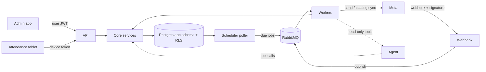

# API boundaries (T-002)

Status: **draft v1 — 2026-11-17**. Depends on T-001 (`docs/domain/domain-glossary-and-rules.md`).
Covers US-014 (sold-out handling across channels), US-036 (queued WhatsApp processing), and US-042 (agent uses the same functions as staff).

## 1. Components

| Component | Runs as | Talks to | Never does |
|---|---|---|---|
| **Admin app** (React, `admin/`) | Static site (Cloudflare Pages or Vercel) | REST API only, with the user's Supabase access token | Call Supabase Data API for `app` tables, call Meta, hold secrets |
| **Attendance tablet** (part of admin app, kiosk route) | Same static site | REST API `/api/v1/device/*` with a device session token | Use a staff token, open any other endpoint |
| **REST API** (FastAPI, `backend/app/api`) | Railway process `api` | Core services → Postgres; publishes to RabbitMQ | Call Meta directly (always via queue), skip RLS context |
| **Webhook** (FastAPI route in the API process) | Railway process `api` | Verifies Meta signature, resolves outlet by phone, publishes to `wa.inbound` | Run order logic, write business tables |
| **Workers** (`backend/app/worker`) | Railway process `worker` | Core services → Postgres; Meta Graph API; RabbitMQ | Expose HTTP (except health), bypass core services |
| **Scheduler poller** | Inside the worker process | `scheduled_jobs` → RabbitMQ `jobs` | Execute business logic itself (handlers do) |
| **Agent layer** (MVP: recommendations only) | Inside the worker process | Read-only tools in MVP; Phase 2 adds validated write tools | Write to any table directly; change stock; post ledger entries |
| **Deterministic core** (`backend/app/core`) | Library used by API and workers | Postgres | Know about HTTP, WhatsApp formats, or React |

The core is a **library, not a service**. The API and workers import the same core functions, so an order created at the counter, from WhatsApp, or by the Phase 2 agent goes through one code path (FR2.8, AC6.4).



## 2. Backend module layout

```
backend/app/
  api/          # FastAPI routers, request/response schemas (pydantic), auth dependencies
    v1/owner/   # owner-only endpoints
    v1/ops/     # owner + staff operational endpoints
    v1/device/  # attendance tablet endpoints
    webhooks/   # Meta webhook (verify + publish only)
  core/         # deterministic domain services: orders, bills, payments, stock, ledger,
                # reservations, attendance, menu, outlets, staff. Pure Python + SQL.
  db/           # connection pool, transaction + RLS context helpers
  messaging/    # RabbitMQ topology, publisher, consumer framework (T-110, T-111)
  worker/       # consumers: inbound flows, outbound sender, catalog sync, job handlers
  agent/        # recommendation agent + tool definitions (T-115)
  config.py     # environment validation (T-003)
  db.py         # psycopg connection helper (T-003; grows into db/ with RLS context, T-113)
  logging.py    # JSON-lines logging (T-003)
  main.py       # FastAPI app factory (T-003)
  serve.py      # API entrypoint (T-003)
```

Packages other than `api/health.py`, `worker/main.py`, and the files above are created by the tasks that need them.

Rules:

1. `core` never imports from `api`, `worker`, or `agent`.
2. `api` and `worker` call `core` functions; they do not run SQL that changes business tables themselves.
3. Every `core` write takes an `ActorContext` (`actor_type`, `actor_id`, `tenant_id`, optional `reason`) (T-008).
4. Every request/message runs in one DB transaction that first sets `app.tenant_id`, `app.user_id`, `app.actor` (Appendix B.4).

## 3. Authentication per surface

| Surface | Credential | Verified by | Tenant/outlet scope |
|---|---|---|---|
| `/api/v1/owner/*`, `/api/v1/ops/*` | Supabase access token (asymmetric JWT, short expiry) | JWKS signature, `iss`, `aud`, `exp`, then live `app.users` row (active, tenant matches) | Tenant from token, re-checked live; outlet access checked live (`staff_outlets` or owner) |
| `/api/v1/device/*` | Device session token issued at pairing (T-121) | Token hash lookup in `attendance_devices`, not revoked | Fixed to one outlet |
| `/webhooks/whatsapp` | Meta `X-Hub-Signature-256` | HMAC with the app secret | Outlet resolved from the receiving phone number id |
| `/healthz`, `/readyz` | None | — | None; no tenant data |
| Workers | No user token; actor `system` (or `agent`) | — | Tenant and outlet from the message or job payload |

Owner-only endpoints check `role = owner` from the live user row, not only the claim. Staff calling an owner endpoint gets `403` and nothing changes (AC1.6).

## 4. REST API conventions

- Base path `/api/v1`. JSON only. Field names `snake_case`, enum values exactly as in T-001.
- Money: integer rupiah (`"total": 92400`). Never strings or decimals. Formatting is the client's job.
- Time: ISO 8601 with offset in responses, rendered in the outlet's zone (`"2026-11-17T19:00:00+08:00"`), plus `outlet.timezone` so clients can label WIB/WITA/WIT.
- Outlet-scoped resources are nested: `/api/v1/ops/outlets/{outlet_id}/orders`. Tenant-level resources are not: `/api/v1/owner/products`.
- Writes that must not run twice accept an `Idempotency-Key` header (order creation, payments, stock movements, shift close).
- Errors use one shape:

  ```json
  { "error": { "code": "item_sold_out", "message": "Croissant Butter habis", "details": { "product_id": "…" } } }
  ```

  Codes are stable identifiers (e.g. `forbidden`, `not_found`, `validation_failed`, `invalid_transition`, `item_sold_out`, `shift_not_open`, `reason_required`, `conflict`). The admin app maps codes to Bahasa Indonesia copy.
- Pagination: cursor based (`?cursor=…&limit=…`), responses include `next_cursor`.
- OpenAPI schema generated from FastAPI is the contract; the admin app generates TypeScript types from it (contract check in CI, T-009).

### Endpoints

The full endpoint list is defined per wireframe screen in [`screen-endpoint-map.md`](screen-endpoint-map.md); that file is the contract. Summary of prefixes:

| Prefix | Who | Screens |
|---|---|---|
| `/api/v1/me` | owner, staff | sidebar, outlet switcher |
| `/api/v1/owner/*` | owner | O1–O14 |
| `/api/v1/ops/outlets/{outlet_id}/*`, `/api/v1/ops/{orders,bills,payment-proofs,reservations,drawers,shifts}/{id}/*` | owner, staff (assigned outlets) | S1–S9, M1–M6 |
| `/api/v1/ops/me/attendance*` | staff (own records) | S9, M6 |
| `/api/v1/device/*` (`pair`, `staff`, `selfies`, `attendance`) | attendance tablet | K0–K4 |
| `/webhooks/whatsapp` | Meta | — (worker flows W1–W12) |
| `/healthz`, `/readyz` | none | — |

## 5. Queue contracts

All messages use one envelope (JSON body, persistent, headers carry routing metadata):

```json
{
  "type": "wa.inbound.message",
  "version": 1,
  "id": "uuid",
  "tenant_id": "uuid",
  "outlet_id": "uuid",
  "occurred_at": "2026-11-17T12:00:00Z",
  "idempotency_key": "wamid.HBgM…",
  "payload": { }
}
```

Headers: `x-correlation-id`, `x-attempt`, `x-failure-reason` (dead letters only).

| Exchange → queue | Message types | Producer | Idempotency key |
|---|---|---|---|
| `wa.inbound` → `wa.inbound.q` | `wa.inbound.message`, `wa.inbound.status` | Webhook | Meta message id (checked against `processed_messages`) |
| `wa.outbound` → `wa.outbound.q` | `wa.outbound.text`, `wa.outbound.interactive`, `wa.outbound.template`, `wa.outbound.product_list`, `wa.outbound.image` | Core services (after commit) | `{order_id}:{event}` or `{reservation_id}:{event}` |
| `catalog.sync` → `catalog.sync.q` | `catalog.upsert_item`, `catalog.set_availability` | Menu, price, stock services | `{outlet_id}:{product_id}` (latest wins) |
| `jobs` → `jobs.due.q` | `job.due` (payload: job id, type) | Scheduler poller | `job_key` |

Publishing from core: outbound and catalog messages are written to the queue **after** the business transaction commits (an outbox table can be added in T-111 if publish-after-commit proves lossy). Topology, retries, and dead-lettering follow Appendix A.

## 6. Agent boundary

- MVP (T-115): the agent gets **read-only** tools: `list_available_products(outlet_id)`, `get_product_tags`, `get_best_sellers(outlet_id, days=30)`, `get_owner_picks`. It returns product ids; the worker builds the WhatsApp product message. No tool writes anything.
- Phase 2: write tools wrap the same core functions as the API (`create_order`, `create_reservation`) and require a customer confirmation token; actor is `agent`. There is no stock or ledger tool (FR4.4, AC6.3).
- The agent runs with actor `agent` in the DB session; its tool layer cannot reach raw SQL.

## 7. Cross-channel rules owned by core

These are implemented once in `core` and reused by every channel:

| Rule | Function (indicative) |
|---|---|
| Price + PB1 + delivery calculation | `core.pricing.quote(outlet, items, order_type)` |
| Stock check + deduction in one transaction, sold-out error naming the item | `core.orders.create_order(ctx, draft)` |
| Status transitions per flow | `core.orders.transition(ctx, order_id, to_status, reason=None)` |
| Payment confirmation and ledger posting | `core.payments.confirm(ctx, …)` → `core.ledger.post_sale(…)` |
| Smallest-free-table booking with DB exclusion constraint | `core.reservations.book(ctx, …)` |
| Unpaid timer, reminders, no-show via `scheduled_jobs` | `core.jobs.schedule(…)` in the same transaction |

## 8. Out of scope for this document

RLS policy details (T-005), JWT claim contract and DB roles (T-113, Appendix B), RabbitMQ declarations (T-110), endpoint-level request/response schemas (written with each task and published through OpenAPI).
